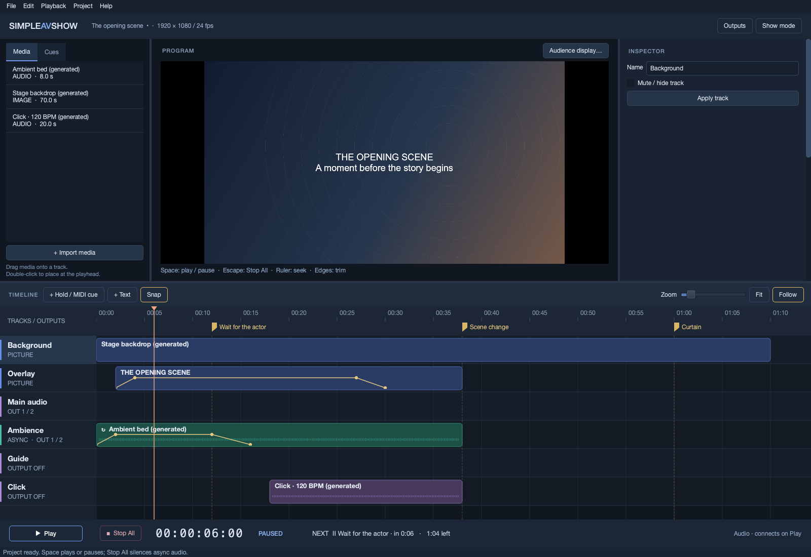

# SimpleAVShow

**A native timeline editor and playback engine built for live stage performances.**

Arrange audio, video, images, text, stage holds, and MIDI cues on one timeline, route private performer feeds to their own outputs, and run the show from a locked Show mode with a fullscreen audience display.

Windows 11 is the primary show target; macOS and Linux run the same C++20 codebase.

> **Prerelease status:** Automated transport, media, persistence, and UI tests pass on Windows, macOS, and Linux, but every live rig is different. Rehearse your full show with the [show-machine validation checklist](docs/hardware-validation.md) on your actual interface, MIDI gear, and projector before taking a build on stage.

## Downloads

Grab the latest build from [GitHub Releases](https://github.com/SimpleAVL/simpleAVshow/releases):

| Platform | Package | How to install |
| --- | --- | --- |
| **Windows 11 (x64)** | `SimpleAVShow-windows-x86_64.zip` | Extract the entire ZIP folder and launch `bin/simpleavshow.exe`. |
| **macOS 15+ (Apple Silicon)** | `SimpleAVShow-macos-arm64.zip` | Extract the ZIP and move `simpleavshow.app` to Applications. *(Intel Macs are not supported.)* |
| **Linux (x64)** | `SimpleAVShow-linux-x86_64.AppImage` | Run `chmod +x` on the AppImage, then launch it. Built on Ubuntu 24.04 (glibc ≥ 2.39). If FUSE is unavailable, set `APPIMAGE_EXTRACT_AND_RUN=1`. |

Every package bundles its runtime libraries, third-party notices, and a copy of the user manual. Prereleases are unsigned (macOS builds use ad-hoc signing without notarization), so your OS may show its standard downloaded-app warning on first launch. Verify downloads against `SHA256SUMS.txt` on the release page.

### Try a sample show right away

- **Built-in demonstration:** Launch with `--demo`, or choose **File → Open demonstration** inside the app.
- **Full real-media show:** Open [The Last Lighthouse](demos/last-lighthouse/README.md) for real MP4/MP3/WAV media, eight-channel stems, async stage waits, MIDI cues, and repeatable recording checks.

## Documentation

Read the **[SimpleAVShow User Manual](docs/README.md)** for step-by-step guides to installation, timeline editing, audio routing, MIDI cues, Show mode, phone remote control, portable packages, recovery, agent collaboration, and troubleshooting. A copy of the manual ships inside every release package.

## What SimpleAVShow does

- **Timeline editing:** Combine audio, video, still images, and text with snapping, trimming, splitting, copy/paste, nudging, and 32-step undo/redo.
- **Layered audience display:** Compose multiple picture layers into one program output and send it fullscreen to a remembered audience monitor or projector.
- **Holds and async playback:** Freeze show time and the stage picture until the operator continues, while already-running async audio and video (ambience beds, loops, projections) keep playing smoothly underneath.
- **Multi-channel audio routing:** Send each track to specific physical outputs—stereo audience speakers, mono guide or click feeds, or silence—with ASIO support on Windows.
- **[Clip automation](docs/editing-a-show.md#automation-and-fade-helpers):** Automate volume, pan, position, scale, and opacity directly on the timeline or in the inspector, using Linear, Hold, Curve, and S-curve segments plus one-click fade helpers.
- **MIDI cues:** Trigger notes, CCs, program changes, pressure, pitch bend, or raw/SysEx messages when playback arrives at a cue or resumes from a hold.
- **Locked Show mode:** Check readiness with a preflight screen, lock out accidental edits and seeks, watch the next-cue countdown, and guard against accidental exits.
- **[Phone remote](docs/remote-control.md):** Play, pause, continue holds, and trigger Stop All from any phone or tablet browser on the same network.
- **Reliable show files:** Atomic saves, automatic crash recovery, missing-media relinking, and self-contained `.savpack` archives that move cleanly between computers.
- **[MCP agent collaboration](docs/agent-collaboration.md):** Optionally connect a local AI agent to build the open show alongside you, sharing undo history and obeying playback locks.

NDI, multiple simultaneous audio devices, MIDI input, audio plugins, and advanced effects are outside v1. See [current limitations](docs/reference-and-troubleshooting.md#current-limitations) for the full scope.

## Building from source and contributing

See [CONTRIBUTING.md](CONTRIBUTING.md) for macOS, Windows, and Linux build steps, test suites, and contribution guidelines. Architecture notes and release automation live in [development/](development/).

## License

SimpleAVShow is free software licensed under the [GNU General Public License v3.0 or later](LICENSE). It is distributed in the hope that it will be useful, but without any warranty.

Each release includes `SimpleAVShow-<version>-source.tar.gz` alongside the binaries, and every package ships with `LICENSE` and third-party notices in `licenses/`. Bundled components keep their own licenses:

- **FFmpeg:** macOS (Homebrew) and Linux (Ubuntu) packages bundle GPL-configured builds; Windows bundles BtbN's LGPL build pinned in [packaging/ffmpeg-windows.json](packaging/ffmpeg-windows.json).
- **ASIO (Windows):** RtAudio is built via the overlay port in [ports/rtaudio](ports/rtaudio) against Steinberg's ASIO SDK 2.3.4 under its GPLv3 option (replacing the older proprietary SDK copies bundled in RtAudio). *"ASIO" is a trademark of Steinberg Media Technologies GmbH.*
- **Qt** (LGPLv3), **RtAudio** and **RtMidi** (MIT), and **libarchive** (BSD) are shipped as replaceable shared libraries.
