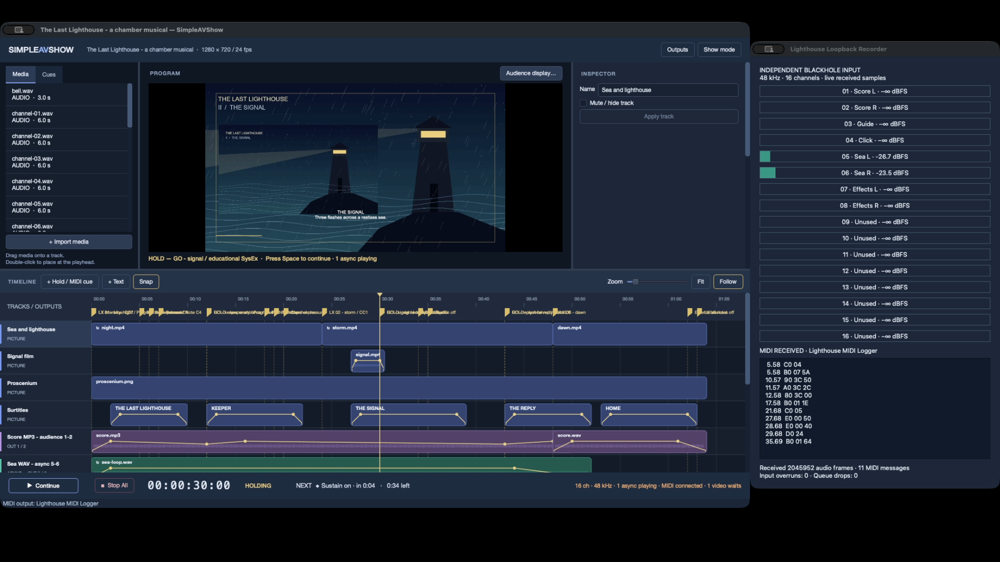

# Validation record — 13 October 2026

**Real BlackHole 16ch loopback, independent MIDI reception and one combined OBS recording passed.** The recording shows the native SimpleAVShow editor alongside the live MIDI logger and sixteen input meters. Its six audio tracks contain full mix, audience score, crew guide, click, async sea and effects.

Open the **[combined six-track MP4](../../artifacts/last-lighthouse/lighthouse-combined.mp4)** or the **[self-contained show package](last-lighthouse.savpack)**. The [hardware validation summary](evidence/hardware-validation-summary.json) links four successful exercises. The device run used 48 kHz, sixteen channels and a 512-frame output buffer. This proves local CoreAudio/BlackHole routing; physical interfaces, lighting hardware, projectors and external AV offsets were not tested.

## Delivered show

- 20 actual files: four H.264 MP4s (one also contains AAC), one MP3, fourteen WAVs and a transparent PNG.
- 11 tracks, 19 clips, 20 cues, 19 MIDI messages, 64 seconds of show time and three actor holds.
- Original animated projections, chamber score with a trimmed WAV reprise/crossfade, spoken guide, click, async sea, async one-shot bell, linked movie/audio effects and four-layer composition.
- Separate eight-channel line-check and async pause/seek projects.
- Native `.savshow` and `.savpack`, generation scripts, independent recorder, OBS setup and fail-closed analyzers. [Reproduction instructions](README.md).

## Results

| Check | Result | Evidence / scope |
| --- | --- | --- |
| Current transport, MCP and app suites | Pass, 3/3 | `ctest --test-dir build --output-on-failure`; rerun before committing the demo. |
| Opt-in rehearsal and native input app builds | Pass | Production desktop/transport code exercised through the rehearsal runner. |
| Native save/reopen and package export/reopen | Pass | [Package audit](evidence/package-runner.json); all twenty extracted assets match their source SHA-256 hashes. |
| Full real-file rehearsal | Pass | [Native show runner](evidence/hardware-show-runner.json); three holds, manual pause and project end. |
| BlackHole output → independent BlackHole input | Pass | [Input capture](evidence/hardware-show-capture.json); separate native app opens input only, never loads the show or opens output. All received frames reached the sixteen-channel WAV. |
| Outputs 1–8 fingerprints | Pass, actual device input | [Routing verification](evidence/hardware-routing-verification.json) and [frequency matrix](evidence/hardware-frequency-routing-matrix.json). Wanted amplitudes about 0.11994; wrong-channel amplitude below 0.000030. |
| Eight simultaneous impulses | Pass, actual device input | Identical sample offsets on all eight channels. |
| Outputs 9–16 | Pass, actual device input | Exactly zero across all four exercises. |
| All 19 MIDI messages, once, ordered | Pass | [Raw CoreMIDI receipts](evidence/hardware-show-midi-received.jsonl) and [show verification](evidence/hardware-show-verification.json). |
| Resume MIDI only after Continue | Pass | Logger receipt followed Continue by about 5.7–8.0 ms. This is local loopback timing, not external rig latency. |
| Holds and manual pause | Pass, actual device input | Synchronous score/guide/click silent; async sea audible on 5–6; completed bell/effects silent. [Show verification](evidence/hardware-show-verification.json). |
| Pause / inside / exact-end / re-entry seek | Pass, actual device input | [Async verification](evidence/hardware-async-verification.json); no MIDI emitted by seeks. |
| Five-minute actor hold | Pass, actual device input | [Long-hold verification](evidence/hardware-long-hold-verification.json): 300.123 seconds at frozen show time 12 seconds, 3,001 frozen-time samples, sea audible in every measured five-second window. |
| Stop All and project end | Pass | All channels silent after Stop All, no remaining async voices. |
| Audio health | Pass | No driver underruns, input overruns, dropped blocks, waits, read retries/failures or clipping; full-show maximum block peak about 0.406. |
| Video health | One initial preparation wait | No playback error; holds retain picture hashes. |
| OBS video | Pass, actual OS window capture | 1920×1080 at 24 fps. Both editor and logger/meter panels are visible and changing in sampled frames. |
| OBS multitrack audio | Pass | One H.264 video and six stereo AAC streams. Every track contains signal; maximum isolated-stem pairwise correlation about 0.0124. [Probe](evidence/hardware-show-obs-probe.json). |
| Physical interface, MIDI rig, projector and AV offsets | Not tested | Local loopback cannot establish external equipment behavior. |

## Recordings and raw artifacts

The **[combined MP4](../../artifacts/last-lighthouse/lighthouse-combined.mp4)** preserves all six OBS audio streams without re-encoding; [encoded-stream SHA-256 verification](evidence/combined-remux-verification.json) confirms the video and every audio stream match the original MKV. A normal player usually plays the first, full-mix track; select another audio track to audition a stem, or import all tracks into an editor. The full mix includes the private guide and click so every feed can be reviewed.

The original OBS MKV and actual sixteen-channel input WAV remain in [combined-validation/show](../../artifacts/last-lighthouse/combined-validation/show/), together with transport telemetry, MIDI receipts, capture metadata and relay logs. Real routing, async and five-minute-hold raw captures remain in [hardware-validation-4](../../artifacts/last-lighthouse/hardware-validation-4/). Small shareable reports and screenshots live in this demo's `evidence/` directory. The OBS probe snapshot stores its recording filename relative to the repository. Recordings and raw captures are local, ignored artifacts and are not included in Git; reproduce them using the commands in README.md.

OBS receives the independently captured input samples through five local AAC/MPEG-TS relays and assigns the received stems to separate recording tracks. ScreenCaptureKit's automatic application audio is muted and excluded from every track to prevent duplicate feeds. The lossless PCM WAV and transport telemetry establish audio behavior; OBS AAC buffering/resampling is not a sample-accurate latency test. The input recorder's first-sample time is estimated from callback time and block duration.

The earlier `hardware-validation-4/show` attempt passed audio and MIDI but failed its video check because OBS was set to application capture without an application selected. The delivered `combined-validation/show` rerun uses fresh window-capture sources and passed both picture panels and all audio/MIDI checks. Failed attempts are retained and are not presented as successful recordings.

## Earlier software evidence

Before the driver and permissions were available, the production mixer was also exercised through an explicitly labeled software path. Those reports remain in [routing verification](evidence/routing-verification.json), [async verification](evidence/async-verification.json), [show verification](evidence/show-verification.json) and [long-hold verification](evidence/long-hold-verification.json). Their `hardware_audio_verified` field remains false.

The earlier [software review MP4](../../artifacts/last-lighthouse/lighthouse-review.mp4) uses native Qt widget snapshots at roughly 1 fps. It is supplementary historical evidence. The combined recording above uses real OS window capture and independently received BlackHole input.
