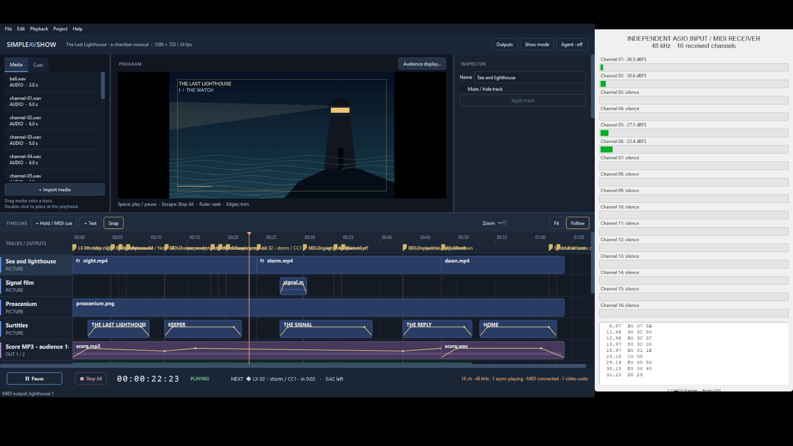

# Windows validation — 2026-10-14

Windows 11 Home build 26100 / AtlasOS; i5-9400F, 16 GB RAM, RTX 2060 SUPER. These results exercise this PC and its installed virtual drivers. No physical ASIO interface or external MIDI hardware was connected.

## Build and native regressions

The 0.4.1 candidate passed all three Windows CTest suites (transport, MCP, app; 34.52 s), packaging and clean-PATH smoke launch. The same source passed all three macOS suites (20.58 s). Native Qt Windows second-monitor regression passed separately. Build evidence is `windows-host-20261014-062655`.

The ASIO inventory regression fails on the old implementation because enumerating a second RtAudio ASIO instance returns no devices while a stream is open. The fix reuses the open instance's device inventory. Regression passes after the fix with both VB-Matrix VASIO-64A (16 selected outputs) and ASIO4ALL v2 (8 outputs), while running, paused and resumed, with callbacks continuing. Before/after logs are retained in `windows-host-20261014-054938`; candidate confirmations are in `windows-host-20261014-062655`.

Manual candidate check: reopened Outputs at the first hold, retained the correct connected device, then Stop All and reopen showed VB-Matrix VASIO-64A (64 outputs), 16 selected outputs and enabled settings. Show mode locked editing, opened the audience picture fullscreen on CF15T and left the editor on the primary screen. Read-only native measurements: program (3840,0), 1920×1080; editor (1192,545), 1456×999. Stop All and leaving Show mode worked, and the app closed cleanly.

The earlier Windows fullscreen-placement fix is merged in PR #12 and released in v0.4.0. The downloaded release ZIP's SHA256 was verified, and the released app opened the Last Lighthouse package with a clean PATH.

## Independent audio/MIDI and OBS evidence

Native RtAudio ASIO output is received by a separate PortAudio process on VB-Matrix VASIO-64B. The capture is 16 channels at 48 kHz. This is a real driver loopback, with `device_loopback_verified=true` and `hardware_audio_verified=false`.

| Run | Driver | Exercises | Result |
| --- | --- | --- | --- |
| windows-20261014-055200 | VB-Matrix VASIO-64A, 16 outputs | Routing, async transport, full show with OBS, five-minute hold | All passed |
| windows-20261014-063718 | Patched 0.4.1 candidate, VB-Matrix 16 outputs | Routing, async transport, full show with OBS | All passed |
| windows-20261014-060406 | ASIO4ALL v2 → VBMatrix Point 1 WDM, 8 outputs | Routing, async transport, full show with OBS | All passed |

The first two runs used application version 0.4.0 at source ec6675b. The final run used the committed 0.4.1 candidate at source a959576, including the ASIO fix.

Eight distinct line-check frequencies reached only their assigned channels, channel impulses aligned, and unused channels 9–16 remained silent. Async sea audio continued through pause/holds and inside seeks, ended correctly, and Stop All silenced every channel. The full show received 19 exact MIDI cues, including three Continue-only hold cues. OBS recorded the real editor with independent meters/MIDI logger, 24 fps video and six independently fed audio tracks. No receiver overflow, queue overflow or runner underrun was reported in the passing runs.

The long hold lasted 300.0166513 wall-clock seconds. All 2,742 sampled states retained show time; all 59 five-second windows retained audible async sea, with minimum RMS 0.0245943. Synchronous stems were silent and held program images matched.

## Preserved failures and limits

The first ASIO4ALL routing attempt immediately after changing the driver's sample rate failed; it is retained in `windows-20261014-055959`. The fresh complete suite above passed. Early harness/OBS setup attempts are retained too.

The opt-in `realDeviceHeartbeatAdvances` default-output, two-channel silent test failed after installing/selecting ASIO4ALL: callbacks did not advance within its 300 ms observation. An idle native Windows run also failed. This is unresolved; the passing explicit eight/sixteen-channel tests do not establish every default-output configuration works. Earlier pre-ASIO installation default stereo heartbeat passed.

Physical multichannel routing, analog quality, production latency, external MIDI devices and other Windows/driver combinations remain unverified. Autologon settings were verified without another reboot.

## Backup, changes and release status

Raw WAV/MKV recordings, all attempts, JUnit/test logs and screenshots are copied to the testing Mac under `~/Downloads/simpleavshow-testing-setup/evidence/windows-artifacts`. `evidence/windows-evidence-manifest.json` provides file sizes and SHA256 hashes for transfer verification. All 525 files (2,061,815,933 bytes) matched their Windows SHA256 and length after transfer. Compact machine-readable summaries are also committed under `demos/last-lighthouse/evidence/windows-20261014`.

PR #16 contains the ASIO fix and prepared v0.4.1 version/release notes. PR #14 contains the demo and Windows validation tools/evidence and is stacked on #16. Both are committed and pushed. GitHub Actions could not start because of the account's failed-payment/spending-limit block. CONTRIBUTING.md requires CI to pass before merging. No merge or v0.4.1 release was performed while CI was blocked.

Representative recorded frame, 30 seconds into the final candidate rehearsal:

