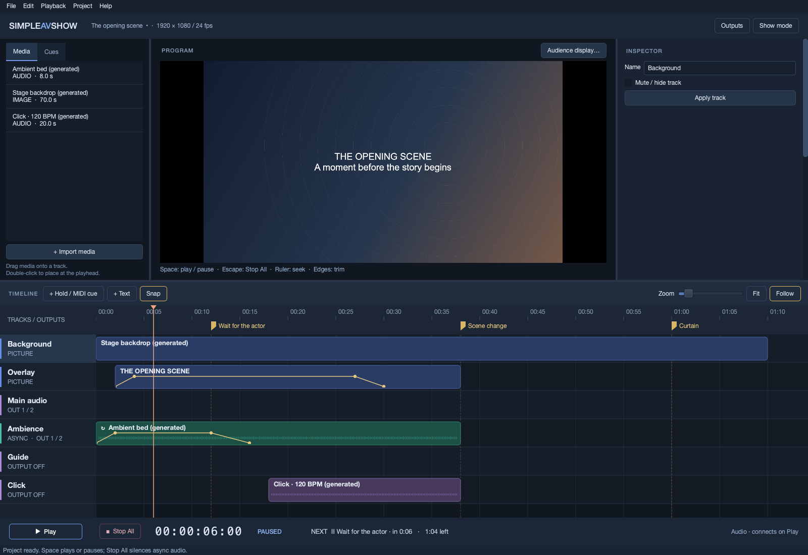

# SimpleAVShow User Manual

SimpleAVShow lets you build a stage show on a timeline—combining sound, video, still images, text, holds, and MIDI cues—and run it reliably in front of a live audience. This manual walks you through setting up, editing, rehearsing, operating, and moving shows between computers.

*Written for **SimpleAVShow 0.6.0**. Screenshots show the native macOS editor; Windows and Linux share the same layout and controls, though device names, fonts, decimal separators, and platform shortcuts can differ.*

> **Prerelease note:** SimpleAVShow is an active development prerelease. Always complete a full rehearsal on your actual show machine before going live—see the [Show-machine validation checklist](hardware-validation.md).

## Where to start

- **New to SimpleAVShow?** Start with [Chapter 1: Getting started](getting-started.md) and run the built-in demonstration.
- **Preparing for a performance?** Review the checklist in [Chapter 5: Running a show](running-a-show.md) and [Show-machine validation](hardware-validation.md).
- **Stuck on a problem right now?** Jump straight to [Chapter 9: Reference and troubleshooting](reference-and-troubleshooting.md).

## Contents

| Chapter | What you will learn |
| --- | --- |
| [1. Getting started](getting-started.md) | Install the app, tour the interface, run the demo show, and build your first scene. |
| [2. Editing a show](editing-a-show.md) | Import media, organize tracks, trim and link clips, add text, and shape automation curves. |
| [3. Audio and outputs](audio-and-outputs.md) | Connect audio interfaces, route audience/guide/click channels, use async playback, and open the audience display. |
| [4. Cues and MIDI](cues-and-midi.md) | Place holds and timed cues, connect MIDI ports, build messages, and test them safely. |
| [5. Running a show](running-a-show.md) | Rehearse, pass the Show mode preflight, run holds and pauses, and handle faults calmly. |
| [6. Phone remote](remote-control.md) | Control playback from a phone or tablet browser on the same network. |
| [7. Saving and recovery](saving-and-recovery.md) | Understand `.savshow` vs. `.savpack`, transfer shows, recover autosaves, and relink missing media. |
| [8. Agent collaboration](agent-collaboration.md) | Connect a local MCP agent to co-edit the live show alongside you. |
| [9. Reference and troubleshooting](reference-and-troubleshooting.md) | Keyboard shortcuts, numeric ranges, health readouts, grouped troubleshooting, cache behavior, and v1 limits. |

## Seven rules worth knowing upfront

Keep these core behaviors in mind as you learn the app—they explain almost everything SimpleAVShow does during rehearsal and performance:

1. **Space is your main transport key.** Outside text and number fields, **Space** plays, pauses, or continues a hold.
2. **Holds and pauses freeze show time, not async media.** Regular audio stops and the picture holds still, while already-running **async** audio and video (like room ambience or looping projections) keep playing. Their automation curves stay frozen until show time resumes.
3. **Stop All silences everything inside the app without rewinding.** In edit mode, press **Escape** (or click **Stop All**). In Show mode, press **Escape twice within 600 ms** (clicking the button always takes one click).
4. **Stop All and leave Show mode before making changes.** You cannot edit the timeline or switch audio/MIDI devices while Show mode is locked or any audio—including async beds—is still running.
5. **Seeking never sends MIDI.** Jumping the playhead around during rehearsal won't accidentally trigger lights or instruments. Landing right on a cue arms it so it fires when you press Play.
6. **Guide and Click start silent on purpose.** Both tracks ship with their outputs set to **Off** so performer feeds can never leak into house speakers by accident. Route them explicitly when you need them.
7. **Normal saves reference external files; packages bundle everything.** Saving a `.savshow` project leaves imported media where it lives on disk. Use **File → Export package…** to create a portable `.savpack` that includes every media file.

## Related resources

- **[Show-machine validation](hardware-validation.md)** — A structured pre-show checklist for verifying ASIO routing, MIDI bridges, displays, and failure recovery on real hardware.
- **[Project README](../README.md)** — Downloads, feature overview, and licensing details.
- **[CONTRIBUTING.md](https://github.com/SimpleAVL/simpleAVshow/blob/main/CONTRIBUTING.md)** — Building from source, running tests, and developer docs in the GitHub repository.
