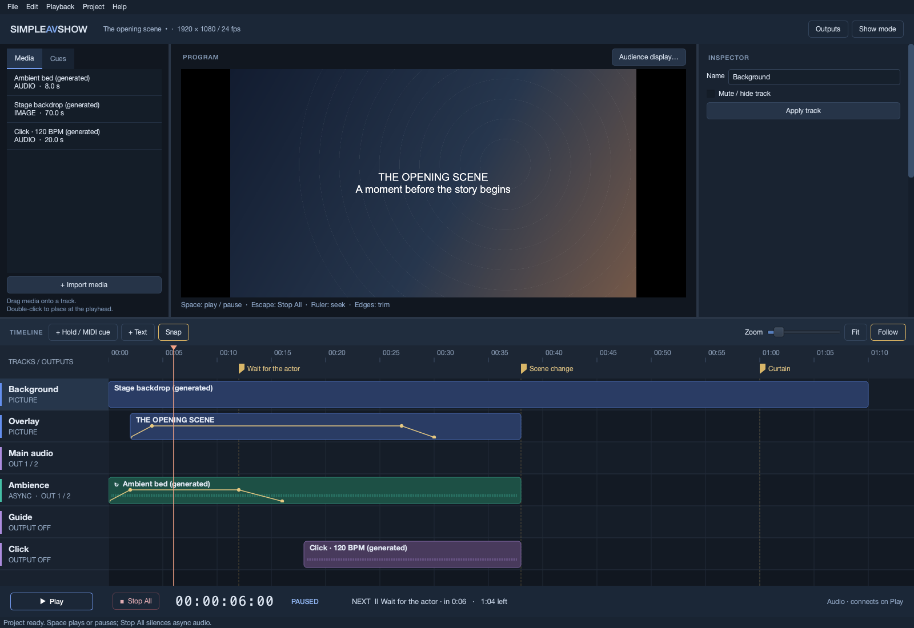

# SimpleAVShow user manual

SimpleAVShow builds and plays stage shows from a timeline of pictures, sound, text, holds, and MIDI cues. This manual covers preparing a show, rehearsing it, operating it, and transferring it to another computer.

This manual describes SimpleAVShow 0.2. Screenshots show the current native editor on macOS; Windows and Linux use the same controls. Device names, fonts, decimal separators, and menu shortcuts can differ. This is a development prototype: complete a rehearsal on the actual show hardware before a performance.

## Chapters

| Chapter | What you will learn |
| --- | --- |
| [1. Getting started](getting-started.md) | Install and launch, tour the workspace, run the demonstration, and create a first show. |
| [2. Editing a show](editing-a-show.md) | Import media, arrange tracks, trim and link clips, add text, and build automation. |
| [3. Audio and outputs](audio-and-outputs.md) | Connect equipment, route audience/guide/click sound, understand async audio, and open the audience display. |
| [4. Cues and MIDI](cues-and-midi.md) | Add holds, navigate cues, program MIDI messages, and test destinations. |
| [5. Running a show](running-a-show.md) | Rehearse, check readiness, enter Show mode, continue holds, and stop playback. |
| [6. Saving and recovery](saving-and-recovery.md) | Save projects, export portable packages, recover autosaves, and relink missing files. |
| [7. Reference and troubleshooting](reference-and-troubleshooting.md) | Look up shortcuts, numeric ranges, health indicators, limitations, and fault recovery. |
| [8. Agent collaboration](agent-collaboration.md) | Connect an MCP agent to build a show alongside the operator. |

For a first session, follow chapter 1 and its demonstration exercise. For a performance, use the checklist in chapter 5. For an immediate problem, go to chapter 7.

## Essential playback rules

- **Space** plays, pauses, or continues a hold when focus is outside an editing field.
- Holds and manual pauses freeze show time and the picture. Already-running **async audio** keeps playing; its automation freezes with show time.
- **Stop All** silences internal audio and keeps the current timeline position. In Show mode, the keyboard shortcut is **Escape twice within 600 ms**; the button takes one click.
- Stop All and leave Show mode before editing or changing audio/MIDI connections. A pause can leave async audio running.
- **Seeking does not send MIDI.** Seeking exactly to a cue arms it for the next Play.
- Guide and Click start disconnected. Route them to their own physical outputs before use.
- Saving a normal project keeps imported media as external files. **Export package…** collects all library media into a portable `.savpack`.

## Other documentation

- [Show-machine validation](hardware-validation.md): a structured rehearsal for routing, drivers, display, MIDI, and failure handling on the actual show computer.
- [Project README](../README.md): downloads, features, and license.
- Building from source and developer documentation: see [CONTRIBUTING.md](https://github.com/staubichsauger/simpleAVshow/blob/main/CONTRIBUTING.md) in the source repository.
