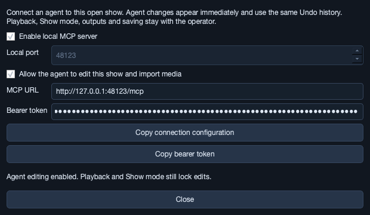

# 8. Agent collaboration

[Manual contents](README.md) · Previous: [7. Saving and recovery](saving-and-recovery.md) · Next: [9. Reference and troubleshooting](reference-and-troubleshooting.md)

SimpleAVShow includes both a built-in **Agent chat** panel powered by the **Agent Client Protocol (ACP)** and an optional local **MCP (Model Context Protocol)** server so an AI assistant on your computer can inspect and help build the live show right alongside you. Changes appear immediately on your timeline, and **Edit → Undo** reverses an entire agent batch in a single step.



---

## Use the built-in Agent chat (ACP)

The quickest way to collaborate with an AI agent is directly inside SimpleAVShow:

1. Click **Agent chat** in the top bar (or choose **Project → Agent chat**, `Ctrl+Shift+A`).
2. Pick an installed ACP-compatible agent from the dropdown — such as **OpenCode** (`opencode acp`), **Claude Code (ACP)** (`claude-agent-acp`), **Codex (ACP)** (`codex-acp`), **Antigravity (agy)** (`agy acp`), **Pi** (`pi-acp`), or **Custom ACP command…**.
3. Click **Connect**. SimpleAVShow automatically starts its local MCP server and attaches it to the agent session—no JSON configuration or bearer tokens to copy. *(For agents that only support stdio MCP servers, SimpleAVShow automatically bridges the connection using its built-in `--mcp-proxy` mode.)*
4. Ask the agent to inspect the show, run preflight checks, preview a frame, or check **Allow edits & controls** to let it edit the show, manage media/files, configure outputs or phone remote, and run rehearsal playback.
5. Any permission requests from the agent appear directly as **Allow / Reject / Cancel** cards above the prompt box. Click **Undo edit** (or **Edit → Undo**) at any time to revert a project edit batch in one step.

> **Keyboard safety:** While focus is inside the Agent chat panel (prompt box, buttons, transcript, logs, or permission cards), `Space`, `Backspace`, and `Delete` stay inside chat and never trigger live playback or delete timeline clips. Outside Show mode, `Escape` still triggers Stop All when you are not actively typing in a text field; in Show mode, double-`Escape` always triggers Stop All even if the prompt box has focus. Click back on the timeline or editor when you want `Space` to control playback.

---

## Connect an external MCP agent

1. Open **Project → Agent collaboration…**, or click **Agent · off** in the top bar.
2. Check **Enable local MCP server**. It starts in **read-only** mode at `http://127.0.0.1:48123/mcp`. *(If port `48123` is already in use, pick a different port before enabling.)*
3. Click **Copy connection configuration** and paste it into your MCP client's settings. If your client asks for a transport, choose **Streamable HTTP**; if it uses separate fields, paste the **MCP URL** and copy the **bearer token** individually.
4. When you're ready to grant full editing and control, check **Allow agent edits and controls (show, media, outputs, remote, files, rehearsal)**. Close the dialog—the server keeps running in the background.
5. Prompt your agent to inspect and edit the open show—for example: *"Read the current show, then add opening titles, a hold at 12 seconds for the actor, and a closing cue at 45 seconds. Keep existing media and routing intact."*

The copied configuration looks like this (using the live URL and token from the dialog):

```json
{
  "mcpServers": {
    "simpleavshow": {
      "url": "http://127.0.0.1:48123/mcp",
      "headers": {
        "Authorization": "Bearer <token copied from the app>"
      }
    }
  }
}
```

### Connection details and limits

- **Local to this window only:** The server binds to `127.0.0.1` on your machine, so remote/cloud-hosted agents cannot reach it.
- **Session-only credentials:** The server starts **off** on every app launch. Disabling it or restarting SimpleAVShow generates a brand-new bearer token, so update your client's config when reconnecting.
- **Protocol support:** Implements MCP versions `2025-11-25`, `2025-06-18`, and `2025-03-26` using Streamable HTTP JSON responses and polling (no server-push notifications or standalone SSE stream). Clients that only speak stdio need an HTTP-to-stdio bridge.
- **Process cleanup (ACP):** Disconnecting or closing SimpleAVShow stops the built-in ACP agent and its child process tree (using a Job Object on Windows and the agent's process group on macOS/Linux; helper daemons that explicitly detach into a new POSIX session may outlive the app).

---

## How co-editing works safely

The top-bar button always tells you what the agent can do right now: **Agent · off**, **read only**, **editing**, or **locked**. Click it anytime to revoke write access or turn the server off immediately. The status bar announces every agent edit and import.

### What the agent can and cannot do

- **Can always read and advise (even during playback or Show mode):** Project settings, tracks, clips, automation curves, cues, media metadata, preflight checks, app/hardware environment (audio/MIDI/displays/remote), MIDI encoding, and the entire built-in user manual. *(Outside Show mode, read-only `render_preview` also renders PNG preview frames at any timeline position.)*
- **Can edit and operate when editing is enabled (and Show mode is off):** Update project settings; add, patch, reorder, split, or delete tracks, clips, automation curves, cues, and unused assets; undo/redo; seek and select items on the timeline; browse, import, and relink local media; configure audio/MIDI/audience display outputs and the phone remote; save/export/open shows; and run rehearsal playback (`play`, `pause`, `continue`, `stop_all`, `seek`). *(New audio tracks created by an agent start disconnected—check their routing before rehearsal.)*
- **Operator-only live guardrail:** **Show mode** stays strictly operator-only. An agent can never enter or leave Show mode, and all mutations, hardware/file changes, and transport controls are automatically blocked while Show mode is active.

### Built-in guardrails

- **Atomic validation:** Every edit batch must leave the show completely valid—no overlapping pictures on one layer, all clips inside project duration, valid track/asset IDs, and valid MIDI/automation data—or the entire batch is rejected cleanly.
- **Single-step undo for project edits:** Timeline, track, clip, cue, import, and relink edits can be reverted in one step via **Edit → Undo**. Note that file actions (`project_action` save/export/open/new) and hardware/remote settings (`configure_outputs`, `configure_remote`) affect disk or device state directly, and opening/replacing a project clears the current undo history.
- **Same locks as the operator:** Agent edits are blocked during Show mode, playback, active async voices, or busy operations. Background media preparation can run while you edit or rehearse, though committing the prepared assets still waits until the editor is unlocked.
- **Optimistic revision checks:** If you edit the show (or even have uncommitted typing in an inspector field, which commits automatically first) after the agent last read it, the agent's write fails with a revision conflict instead of overwriting your work. The agent simply reads the latest show and retries.
- **Linked clips stay linked:** Moving, trimming, or deleting one clip in a linked video/audio pair updates its partner automatically. To detach them, the agent patches the clip with an empty `link` first.

---

## MCP tools and data model

| Tool | Purpose |
| --- | --- |
| `get_show` | Returns the full project snapshot, library metadata, operator state, and current `revision`. *(Also available as MCP resource `simpleavshow://show`.)* |
| `get_preflight` | Runs Show-mode readiness checks and reports missing media, disconnected audio tracks containing clips, unused assets, next cue, and show summary. Safe during playback and Show mode. |
| `render_preview` | Renders the composed program picture at any timeline frame (`time`, defaulting to the current playhead) as a PNG image plus active clip/marker metadata, without moving the playhead (paused during Show mode to protect live program output). |
| `get_environment` | Reports app version, OS, audio/MIDI settings and available devices (probed only while stopped), health counters, connected displays, phone remote status, undo/redo depth, and selection. *(Also exposed as `simpleavshow://environment`.)* |
| `get_app_guide` | Reads any chapter of SimpleAVShow's built-in user manual (`topic`) or searches across all chapters (`query`) for rules, settings, shortcuts, and troubleshooting. *(Chapters are also exposed as `simpleavshow://docs/<topic>` resources.)* |
| `encode_midi` | Converts musical MIDI parameters (Note On/Off, CC, Program Change, Pressure, Pitch Bend, or hex/SysEx) into validated byte arrays for cues. |
| `apply_edits` | Atomically applies up to 256 `project`, `track`, `clip` (including all 6 automation curves with `linear`/`hold`/`curve`/`scurve` shapes and bend), `marker`, `split_clip`, `move_track`, `delete_clip`, `delete_marker`, `delete_track`, or `delete_asset` operations. |
| `history` | Steps backward (`undo`) or forward (`redo`) through the shared 32-step undo history. |
| `seek_and_select` | Jumps the playhead and/or selects a track, clip, or marker in the timeline and inspector (never sends MIDI). |
| `list_media_files` | Lists supported audio, video, and image files in a local folder before importing. |
| `import_media` | Starts background preparation for up to 64 absolute local file paths; returns a `job_id`. |
| `get_import` | Polls an import job until `ready` or `failed`, returning prepared asset IDs and metadata. |
| `commit_import` | Adds the staged assets to the Media library as one undo step using a fresh show `revision`. |
| `relink_media` | Searches a local folder recursively by file name to relink offline assets in one undo step. |
| `configure_outputs` | Configures audio driver/device/channels/buffer, MIDI output port, audience display, or sends a single test MIDI message (stopped, outside Show mode). |
| `configure_remote` | Starts/stops the phone remote, sets its port, or rotates its secret key (outside Show mode). |
| `project_action` | Saves `.savshow`, saves as, exports `.savpack`, creates a new show, opens the demo, or opens an existing show/package (refuses to overwrite existing files on `save_as`/`export_package` unless `overwrite: true`, and refuses to discard unsaved edits unless `discard_unsaved: true`). |
| `transport_control` | Rehearsal playback control (`play`, `pause`, `continue`, `stop_all`, `seek`); strictly blocked in Show mode. |

### Key conventions for agent callers

- **Timing unit = 48,000 Hz audio frames:** Multiply seconds by `48000` and round to an integer (independent of picture fps).
- **Zero-based indices:** Track indices and physical audio output numbers are zero-based; `-1` disconnects an audio leg.
- **Automation points:** Ordered `[clip_relative_frame, value]` pairs, optionally followed by segment shape and bend for the segment to the next point: `[96000, 1, "curve", 0.5]` (shapes: `"linear"`, `"hold"`, `"curve"`, `"scurve"`; bend `−1…1`, `0` = straight).
- **Create vs. patch:** `track`, `clip`, and `marker` operations patch an existing ID (leaving omitted fields intact) or create a new entry if the ID doesn't exist yet. Creating a clip requires `track`, `duration`, and either `text` or an imported `asset` ID—asset file paths cannot be set through `apply_edits`.

### Example `apply_edits` payload

Adds a 5-second fading title on track 1 and a hold cue at 12 seconds (`12 × 48000 = 576000`). Always use the latest `revision` from `get_show`, confirm track 1 is an available picture layer, and extend project duration first if needed:

```json
{
  "expected_revision": 3,
  "operations": [
    {
      "type": "clip",
      "id": "opening-title",
      "fields": {
        "track": 1,
        "text": "Welcome",
        "start": 0,
        "duration": 240000,
        "alpha": [[0, 0], [48000, 1], [192000, 1], [240000, 0]]
      }
    },
    {
      "type": "marker",
      "id": "actor-ready",
      "fields": {
        "name": "Wait for actor",
        "time": 576000,
        "hold": true
      }
    }
  ]
}
```

### Importing media via MCP

`import_media` stages the entire batch off-timeline first—if any single file fails, nothing is added to the library. Only one staged job is kept at a time (starting a new import replaces the previous finished/staged job). Once `get_import` reports `ready`, read `get_show` for a fresh revision and call `commit_import` (conflicts or temporary locks keep the staged assets ready to retry). Afterward, place clips with `apply_edits` using the returned asset IDs. *(For a video with sound, create both a picture clip and an audio clip sharing the same non-empty `link` string to keep them paired.)*

---

## Troubleshooting agent connections

| Issue | Fix |
| --- | --- |
| **Server cannot start** | Port `48123` is occupied by another app or window. Disable the server, pick a free port, and re-enable it. |
| **Unauthorized (401)** | Copy the current bearer token from the dialog—it rotates every time the server restarts. |
| **Agent editing disabled** | Check **Allow agent edits and controls (show, media, outputs, remote, files, rehearsal)** in the collaboration dialog. |
| **Editing locked** | Leave **Show mode**, click **Stop All** (including async voices), or wait for a busy operation to finish. |
| **Revision conflict** | Have the agent call `get_show` again and reapply its edits against the latest revision. |
| **Media preparation failed** | Check the job's error message and verify the absolute local path; failed batches leave the library unchanged. |
| **HTTP GET returns 405** | Expected—this endpoint does not serve a standalone SSE stream. Use a Streamable HTTP client that handles JSON responses. |
