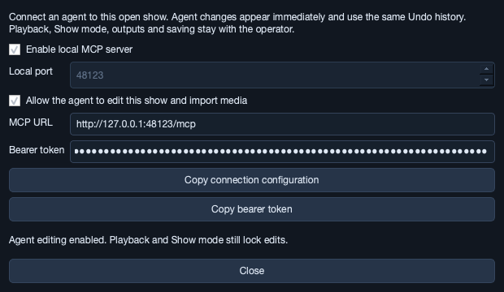

# 8. Agent collaboration

An MCP agent can help build the show that is currently open in the editor. Both the agent and the operator use the same project: changes appear immediately on the timeline, and **Edit → Undo** reverses an agent batch in one step.



## Connect an agent

1. Open **Project → Agent collaboration…**, or click **Agent · off** in the top bar.
2. Check **Enable local MCP server**. It starts in read-only mode at `http://127.0.0.1:48123/mcp`. Choose another port before enabling if that port is occupied.
3. Click **Copy connection configuration** and add it to the agent client's MCP settings. Choose **Streamable HTTP** if the client asks for a transport. Clients with separate fields need the **MCP URL** and the copied **bearer token**.
4. Check **Allow the agent to edit this show and import media** to build together. Close the dialog; the server keeps running.
5. Ask the agent to read the current show and make changes. For example: “Add opening titles, a hold at 12 seconds for the actor, and a closing cue at 45 seconds. Keep the existing media and routing.”

The copied JSON has this structure; use the real URL and token from the dialog:

```json
{
  "mcpServers": {
    "simpleavshow": {
      "url": "http://127.0.0.1:48123/mcp",
      "headers": {
        "Authorization": "Bearer <token copied from the app>"
      }
    }
  }
}
```

Client configuration formats vary. The endpoint and `Authorization: Bearer …` header are the connection details. The server speaks MCP versions `2025-11-25`, `2025-06-18`, and `2025-03-26`; it uses JSON responses and polling rather than server notifications. A client that supports only stdio needs an HTTP-to-stdio bridge.

The server connects to this particular app window on this computer. A hosted agent cannot reach your computer's loopback URL. Enabling does not persist across app launches; disabling or restarting creates a new token, so update the client configuration when reconnecting.

## Work together

The top-bar Agent button shows **off**, **read only**, **editing**, or **locked**. Open it at any time to revoke editing or disable the connection entirely. The status bar reports agent changes and media preparation.

The agent can read project settings, tracks, clips, automation, cues, media metadata, and the current operator state. With editing enabled, it can add or patch project settings, tracks, clips and cues, delete clips/cues, and import local audio, images, and video. New audio tracks start disconnected; inspect their routing before rehearsal.

Agent batches must validate as complete shows: picture clips cannot overlap on one layer, clip times must fit inside the show, assets and tracks must exist, and MIDI messages and automation must be valid. Linked picture/sound clips trim, move, and delete together. Use a patch with an empty `link` to unlink before changing a partner independently.

Changes remain unsaved until the operator saves. Use **Undo** to reject a batch. The operator controls playback, audience displays, audio/MIDI equipment, Show mode, saving, opening, and package export.

Agent edits obey the same locks as operator edits: leave Show mode, use **Stop All** to silence playback and async voices, and wait for any busy operation to finish. Reading still works while running the show. Media preparation can finish in the background while the operator edits or rehearses, but adding prepared assets waits for editability.

If the operator changes the show after the agent reads it, the agent's write fails with a revision conflict. The agent must read the show again and adjust its batch to the current state. Pending inspector fields are committed before checking an agent write, so uncommitted typing also causes a conflict rather than being overwritten.

## Tools and timing

| Tool | Purpose |
| --- | --- |
| `get_show` | Read the current project, library metadata, operator state and revision. |
| `apply_edits` | Apply `project`, `track`, `clip`, `marker`, `delete_clip`, or `delete_marker` operations atomically. |
| `import_media` | Start preparing up to 64 absolute local file paths; returns a `job_id`. |
| `get_import` | Poll that job until `ready` or `failed`; inspect the prepared asset IDs and metadata. |
| `commit_import` | Add the ready assets as one undo step, using a fresh show revision. |

`simpleavshow://show` is also exposed as a readable MCP resource with the same snapshot as `get_show`.

All timeline and automation times are **48,000 Hz audio frames**: multiply seconds by 48,000 and round to an integer. They are independent of the picture frame rate. Track indices and physical audio channel numbers are zero-based; routing `-1` disconnects a leg. Automation points are ordered `[clip-relative time, value]` pairs.

Here is an `apply_edits` argument that adds a five-second title and a hold at 12 seconds. Replace `expected_revision` with the revision returned by `get_show`, check that track 1 is a compatible empty picture layer, and extend the project duration first if needed:

```json
{
  "expected_revision": 3,
  "operations": [
    {
      "type": "clip",
      "id": "opening-title",
      "fields": {
        "track": 1,
        "text": "Welcome",
        "start": 0,
        "duration": 240000,
        "alpha": [[0, 0], [48000, 1], [192000, 1], [240000, 0]]
      }
    },
    {
      "type": "marker",
      "id": "actor-ready",
      "fields": {
        "name": "Wait for actor",
        "time": 576000,
        "hold": true
      }
    }
  ]
}
```

`track`, `clip`, and `marker` operations patch an existing ID, or create an entry when the caller-chosen ID is new. Omitted fields on an existing entry remain intact. Clip creation requires `track` and `duration`, plus `text` or an imported `asset` ID. No asset paths can be changed through `apply_edits`; import prepares and validates sources first. Use unique new IDs and retain IDs from `get_show` when editing existing entries. A batch supports up to 256 operations.

Import stages the entire batch before changing the library. If any source fails, no assets are added. Only one preparation job is retained; a new import replaces the previous completed/staged job. Once ready, read `get_show` again and call `commit_import` with its revision. Conflicts or temporary locks retain the prepared assets for retry. After adding them, create clips using the returned IDs; video sound requires a separate audio clip, and a common nonempty `link` keeps the pair together.

## Troubleshooting

- **Cannot start:** another app/window may be using the port. Disable, choose another port, and enable again.
- **Unauthorized:** copy the current bearer token. It changes when the server restarts.
- **Agent editing disabled:** enable the editing checkbox in the collaboration dialog.
- **Editing locked:** the operator must leave Show mode and Stop All playback, or finish the current busy operation.
- **Revision conflict:** reread `get_show` and rebase on the operator's current show.
- **Media preparation failed:** inspect the job's error and the local path. A failed batch changes no library entries.
- **HTTP GET returns 405:** expected; this endpoint has no standalone SSE stream. Use a Streamable HTTP client that supports JSON responses.

[Back to the manual](README.md)
