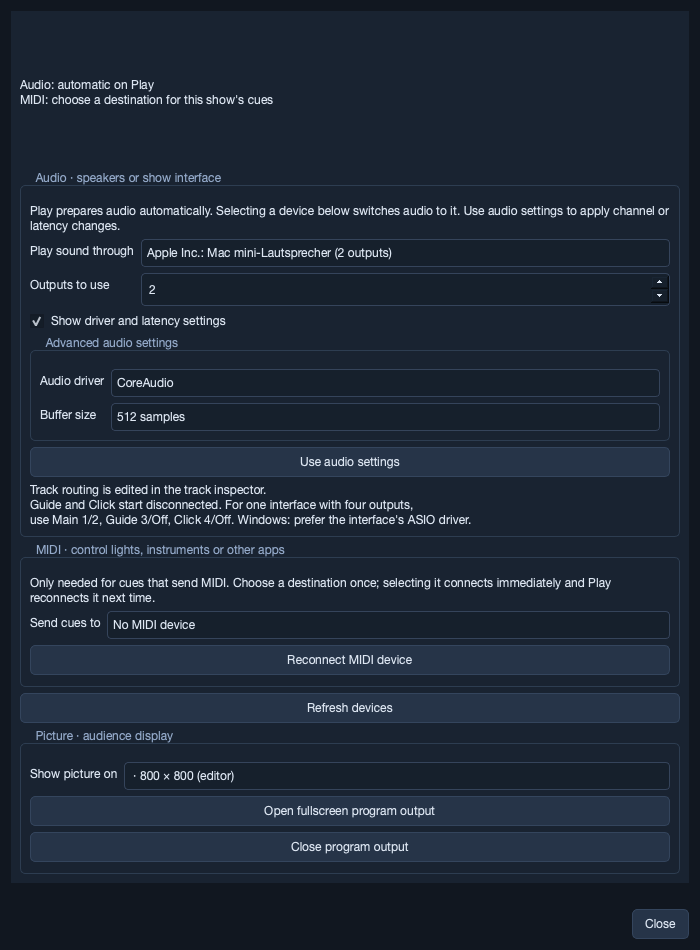
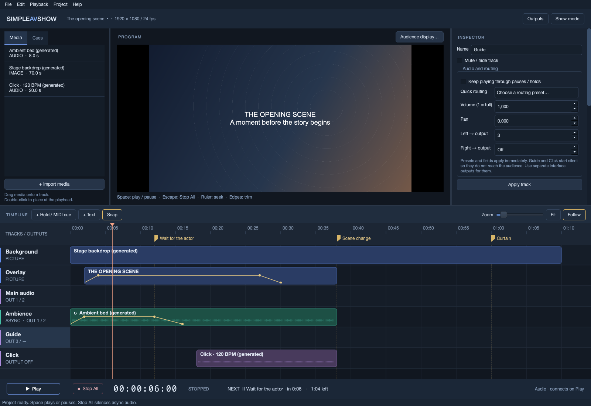

# 3. Audio and outputs

[Manual contents](README.md) · Previous: [2. Editing a show](editing-a-show.md) · Next: [4. Cues and MIDI](cues-and-midi.md)

This chapter explains how to connect your audio interface, configure playback reliability, route tracks to separate physical outputs (such as house speakers, crew guide, and performer click), use async audio and video for live stage waits, and send the program picture to your audience screen.

---

## Connect an audio output

Open the Outputs dialog from the **Outputs** button in the top bar, **Audience display…** above the preview, or **Project → Outputs…**.

> **Important:** Click **Stop All** and leave **Show mode** before changing audio or MIDI connections. In edit mode you can open Outputs during playback to inspect settings (with a **Stop All to change connections** shortcut inside), but in Show mode or during media preparation the dialog is completely locked.

*(This screenshot shows a macOS CoreAudio device and virtual display; your interface and screens will appear with their own names and channel counts.)*

1. Plug in your audio interface, then click **Refresh devices**.
2. **On Windows show PCs:** Check **Show driver and latency settings** and pick your interface's native **ASIO** driver under **Audio driver** whenever available.
3. Choose your interface under **Play sound through**—selecting an available device connects it immediately using the displayed channel and buffer settings.
4. Set **Outputs to use** to at least as many physical channels as your show routes to.
5. Adjust **Buffer size** under the advanced settings if needed, then click **Use audio settings** to apply channel or buffer changes. Check the connection message and status bar to confirm.

### Sample rate, buffer size, and remembered devices

- **Fixed 48 kHz engine:** SimpleAVShow always runs its audio engine at **48 kHz**.
- **Buffer sizes:** Choose **128, 256, 512 (default), 1024, or 2048 samples**. Smaller buffers lower buffering delay; larger buffers give the computer more headroom against crackles and underruns. Always test stability with your actual show rather than guessing from buffer size alone.
- **No silent fallback:** SimpleAVShow remembers your driver, device name, channel count, and buffer size locally on this computer. On first run, pressing **Play** opens the system default output; after that, it reconnects to your remembered device automatically. If that device is unplugged, playback **stays blocked** instead of quietly falling back to laptop speakers—reconnect it and click **Refresh devices**, or explicitly pick a replacement.

---

## Playback reliability

The **Playback · audio reliability** group in **Outputs** holds two per-machine settings:

| Setting | Choice | Use it when |
| --- | --- | --- |
| **Audio sources** | **Stream from media files · fast import** *(default)* | Building and iterating on a show. Compressed audio (MP3, AAC/M4A, FLAC, Ogg, video soundtracks, and WAV at other sample rates) decodes from the original file while it plays—imports skip the disk cache and reopen almost instantly. |
| | **Prepared cache · steadiest playback** | Rehearsing and performing. Every compressed source is decoded once into a disk cache so playback only reads samples. Choose this on the show machine. |
| **If audio is late** | **Freeze show time until it is ready** *(default)* | The show is self-contained. A late read pauses the whole show for that moment so every track, cue, and hold stays aligned; the show runs slightly late. |
| | **Keep time and leave a short gap** | The show must stay on time with outside clocks such as a live band, timecode, or external video player. Only the late sound drops out briefly and fades back in at the correct place. |

- **Same timeline alignment:** Both source modes place every sample at the same show frame, so switching moves nothing on the timeline. Click **Stop All** first—switching prepares or releases the open show's audio with a progress dialog. Compatible 48 kHz PCM WAV files always play directly from their source in either mode.
- **Preflight and counters:** Show mode's preflight warns while audio still streams. Late audio is rare in either mode; the status bar counts **audio waits** (Freeze) and **audio gaps** (Gap) so you can spot it during rehearsals. Jumping on the timeline always starts reading the new place, so a brief wait or gap right after a jump is normal and not counted.
- **Clear audio cache:** Shows how much disk space prepared audio and waveform files use and removes everything the open show is not using. Other shows prepare or measure their audio again the next time they open.

---

## Route tracks to physical channels

Select any audio track header to open **Audio and routing** in the inspector.

Use **Quick routing** for one-click presets (stereo **1+2**, **Silent**, or single-output mono feeds), or set **Left → output** and **Right → output** manually to any 1-based physical output number (or **Off** to disconnect that leg). Before an interface is connected, mono presets list outputs 1–4; once connected, they match the interface's open channels.

### Example: typical four-channel theatre setup

| Track | Left → output | Right → output | Where it goes |
| --- | --- | --- | --- |
| **Main audio** | 1 | 2 | Audience stereo PA. |
| **Ambience** | 1 | 2 | Audience stereo bed. |
| **Guide** | 3 | Off | Crew / performer spoken guide (mono). |
| **Click** | 4 | Off | Performer click track (mono). |

For this layout, set **Outputs to use** to **4** (or more) in Outputs. If any unmuted track routes to a channel higher than the open channel count, SimpleAVShow blocks **Play** so nothing disappears silently. Muting an unused track excludes it from that check.

> **Safety tip:** **Guide** and **Click** start with both outputs set to **Off** on every new project. Always verify each physical channel with a distinct test sound and check your cabling—track names alone don't guarantee the right wire is plugged into the right desk input.

### Volume, pan, and clipping

- **Volume (`1` = full):** Track volume multiplies each clip's base gain (or its active Volume automation curve). Values are linear multipliers (`0` = silence, `0.5` = half amplitude, `1` = unity, up to `4`). Overlapping clips on the same or different tracks add together at the output.
- **Pan with two connected legs:** Track pan and clip/automated pan add together (clamped to `−1…+1`). Mono files use equal-power panning; stereo files use left/right balance.
- **Mono routing (exactly one connected leg):** Mono files play at full unity level, stereo files sum as `(left + right) / 2` so neither channel is lost, and **pan has no effect**. *(Watch out for phase-inverted stereo material, which can cancel when summed to mono.)*
- **CLIPPING indicator:** If summed outputs exceed full scale (or produce invalid samples), SimpleAVShow clamps the output and lights **CLIPPING** in the transport health readout. Lower your track or clip gains, rehearse the loudest overlap, and click **Stop All** to clear the latch.

---

## Synchronous and async audio and video

Live stage timing rarely matches a stopwatch—actors pause for laughs, entrances run long, or a scene change takes extra seconds. SimpleAVShow handles this by splitting tracks into two behaviors:

- **Synchronous (ordinary) tracks** stay locked to **show time**. When a hold or pause freezes show time, synchronous audio stops and synchronous video holds its frame.
- **Async tracks** have **Keep playing through pauses / holds** checked in the track inspector (**Ambience** starts this way by default). Once an async clip starts playing, its media keeps running smoothly on its own clock even while show time is frozen.

Here is how the two compare across every transport action:

| What happens | Ordinary (synchronous) track | Already-running async track |
| --- | --- | --- |
| **Normal playback** | Follows show time. | Media advances on its own clock. |
| **Hold or manual Pause** | Audio stops; video freezes. | **Media keeps playing**; automation curves freeze at the current show time. |
| **Continue / Play** | Resumes from timeline position. | Keeps its live media position seamlessly; automation resumes advancing. |
| **Seek inside the clip** | Jumps to the new timeline position. | Keeps its live media position uninterrupted. |
| **Seek outside the clip** *(including exact clip end)* | Leaves the clip. | Stops the active voice. |
| **Stop All or end of show** | Stops. | Stops. |

### Helpful async details

- **Half-open intervals:** A clip is active from its **Start** up to (but not including) its **End**.
- **Starting mid-clip:** Seeking into an inactive async clip while paused does not start it automatically; pressing **Play** starts it at `Source in + (playhead − Start)`.
- **Loops vs. one-shots during long holds:** A looping async clip keeps cycling cleanly from **Source in** to source end for as long as the hold lasts. A non-looping one-shot can finish naturally during a long hold and stays finished when you **Continue** (for video, it holds its final frame until show time leaves the clip).
- **Fading out after a hold:** Because automation follows show time, an async ambient bed can loop for five minutes at a hold while staying at full volume, then fade smoothly to zero the instant you press **Continue**. Use the **After hold** helper in the inspector to build this in one click.

### Async video specifics

Async picture layers follow the exact same rules for video clips (still images and text on an async layer behave normally):

- **Clocked by the audio engine:** Because the audio device drives async timing, an active audio output is required for async video just like async audio.
- **Linked sound must also be async:** If a video has linked audio, both clips must be on async tracks (otherwise picture and sound would drift apart at the first hold). Dropping a video with sound onto an async picture layer automatically links its sound to the first async audio track—add an async audio track first if the project doesn't have one.
- **Rehearse with real playback:** **Stop All**, timeline edits, and device changes reset async voice state, so always rehearse async phase and fades by actually playing through them rather than only scrubbing.

---

## Open the audience display

SimpleAVShow composes all picture layers into one program image, shared by the editor's **PROGRAM** preview and the fullscreen audience window.

1. Connect your projector or external monitor and arrange displays in your operating system settings (extended desktop, not mirrored).
2. Open **Outputs** and scroll to **Picture · audience display**.
3. Pick the target screen under **Show picture on**. Whichever screen currently holds the editor is marked **(editor)**.
4. Click **Open fullscreen program output**. A frameless, black-backed fullscreen window opens with the mouse cursor hidden.
5. Glance at the actual physical screen to verify framing, then close **Outputs** before entering **Show mode**.

### Managing the output window

- **Closing it:** Click **Close program output** in Outputs, or focus the output window and press your platform's Close shortcut (**Ctrl+W** on Windows/Linux, **Command+W** on macOS).
- **Covering the editor by mistake:** If you pick the screen marked **(editor)**, SimpleAVShow warns you before opening and reminds you of the Close shortcut. Use a dedicated second display for shows.
- **Remembered, not auto-opened:** SimpleAVShow remembers which display you picked on this computer, but opening the fullscreen window is always an intentional click each session.
- **If the display cable disconnects:** SimpleAVShow hides the output window and displays a warning. If the same screen reconnects (and isn't the editor's display), it attempts to reopen automatically. Test how your projector and HDMI chain behave beforehand—auto-reopen is a safety net, not a replacement for locking cables.

> **Moving a show to another computer?** Track routing travels inside your `.savshow` / `.savpack` file, while audio interface, playback reliability, MIDI port, and display choices are stored locally per machine. Always open **Outputs** and verify them after moving a show.
