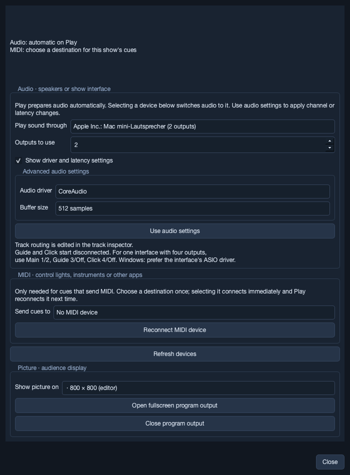
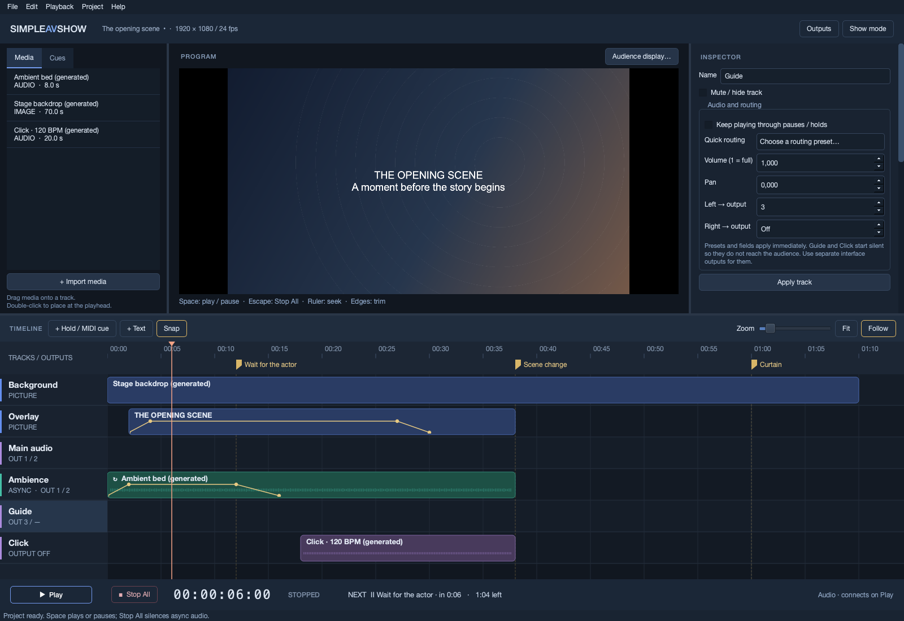

# 3. Audio and outputs

[Manual contents](README.md) · Previous: [Editing a show](editing-a-show.md) · Next: [Cues and MIDI](cues-and-midi.md)

## Connect an audio output

Click **Outputs**, **Audience display…**, or **Project → Outputs…**. Stop All and leave Show mode before changing audio or MIDI connections.

This screenshot shows the capture computer's CoreAudio device and a virtual capture display. Your physical interface and monitors will have different names and channel counts.

1. Plug in the intended interface, then click **Refresh devices**.
2. For Windows show hardware, check **Show driver and latency settings**, then choose the interface's **ASIO** driver under **Audio driver**, when available.
3. Choose **Play sound through**. Selecting an available device connects it immediately using the currently displayed settings.
4. Set **Outputs to use** to the number of physical channels needed by the show. The maximum follows the selected interface.
5. Choose **Buffer size** in the advanced settings if needed.
6. Click **Use audio settings** to apply channel/buffer changes. Read the connection feedback and status bar.

The engine runs at **48 kHz**. Buffer choices are 128, 256, 512, 1024, and 2048 samples; 512 is the default. Smaller buffers reduce buffering delay; larger buffers can improve stability. Measure performance with your interface rather than treating the buffer setting as total system latency.

The app remembers driver, device name, channel count, and buffer setting on this computer. Play prepares the remembered output automatically; on first use it chooses the default output. If the remembered device disappears, playback remains blocked rather than silently switching speakers. Reconnect it and Refresh, or explicitly select a replacement.

The Outputs dialog can be inspected during playback/holds in edit mode. Audio/MIDI connection controls are then disabled, with a **Stop All to change connections** button. Program-display controls remain available. In Show mode, or during media preparation, the Outputs entry points are disabled entirely.

## Route tracks to physical channels

Click an audio track header. Its inspector shows **Audio and routing**.

**Quick routing** offers stereo outputs 1+2, Silent, and one-output mono presets. Presets apply immediately. Before an interface is connected, mono presets cover outputs 1–4; after connection they follow the interface's open channels. **Left → output** and **Right → output** accept custom channel numbers. **Off** disconnects a leg; displayed output numbers are one-based physical channels.

A common four-channel arrangement is:

| Track | Left → output | Right → output | Destination |
| --- | --- | --- | --- |
| Main audio | 1 | 2 | Audience stereo. |
| Ambience | 1 | 2 | Audience stereo bed. |
| Guide | 3 | Off | Performer/crew guide. |
| Click | 4 | Off | Performer click. |

Open **four channels** in Outputs for that arrangement. Routing a track to output 4 while opening only two channels blocks Play. Muted tracks are excluded from this routing check.

Guide and Click start with both legs Off. Use separate interface channels/cabling to keep them out of audience speakers. Verify each channel physically with a distinct signal; the track labels do not prove the wiring is correct.

### Gain and pan

**Volume (1 = full)** controls the track gain. Clip **Gain** supplies the clip's base level unless a Volume curve exists. Track gain multiplies the clip's base/automated volume; overlapping clips add at the destination. Values are linear multipliers: `0` is silence, `0.5` is half amplitude, and `1` is unity.

With two connected legs, track and clip/automated pan combine and are clamped to −1…+1. Mono sources use equal-power panning; stereo sources use balance. With exactly **one connected leg**, mono plays at full level, stereo is summed as `(left + right) / 2`, and pan has no effect. This preserves both sides of a stereo source for a mono guide/click route. Phase-opposed stereo material can still cancel when summed.

**CLIPPING** means the summed signal exceeded full scale or contained non-finite samples. The output is clamped; lower gains and rehearse the loudest overlaps. Stop All resets the clipping indicator.

## Synchronous and async audio

An ordinary audio track follows timeline time. An async track has **Keep playing through pauses / holds** checked. Ambience uses this setting by default; you can change it on any audio track while editing.

| Event | Ordinary audio | Already-running async audio |
| --- | --- | --- |
| Playback advances | Follows show time. | Source advances independently. |
| Hold or manual pause | Stops sounding; picture/show time freeze. | Source continues; automation freezes at current show time. |
| Continue / Play | Resumes at timeline position. | Keeps its current source position; automation advances again. |
| Seek inside the clip's active interval | Jumps to the sought source position on playback. | Keeps its source cursor. |
| Seek outside the interval, including exactly clip end | Leaves the clip. | Stops the voice. |
| Stop All or project end | Stops. | Stops. |

Clip intervals include Start and exclude End. Seeking into an inactive async clip does not start it while paused; playback starts it at `Source in + (sought time − Start)`. A non-looping async source can finish during a long hold and stays finished when you Continue. A looping async source keeps repeating from Source in to source end.

At the same held show time, an async source may have played for minutes. Its fade remains at the hold's value until Continue. This is the intended way to sustain ambience beneath an unpredictable stage wait, then fade it as the next action begins.

Stop All clears voice state. Edits/device changes can rebuild it too. Use actual playback to rehearse the source phase and fades; seeking alone cannot reproduce elapsed async playback.

## Open the audience display

1. Connect the projector/monitor and configure the operating system's display arrangement.
2. Open Outputs and find **Picture · audience display**. Scroll if necessary.
3. Choose **Show picture on**. The editor's current display is labeled **(editor)**.
4. Click **Open fullscreen program output**. The audience window is frameless, black-backed, and hides the cursor.
5. Confirm the picture on the physical screen, then close Outputs before entering Show mode.

The chosen display name is remembered locally. Opening output is still an explicit action each session. **Close program output** hides the window. The standard Close shortcut on the output window also hides it: typically Ctrl+W on Windows/Linux or Command+W on macOS.

If you choose the editor's display, the app asks before covering the editor and tells you the Close shortcut. Use a separate screen for normal operation. The project picture preserves aspect ratio when fitted to the output; the editor preview and audience output share the composition.

If an open audience display disconnects, the app hides its output window and reports the problem. It attempts to reopen when the same display returns on a screen other than the editor's. Verify reconnection behavior with your actual HDMI/display setup; it is not a substitute for stable cabling.

Audio, MIDI, and display selections are local to the computer. Track routing travels with the project/package. Reconfigure and validate all three destinations after moving a show.
