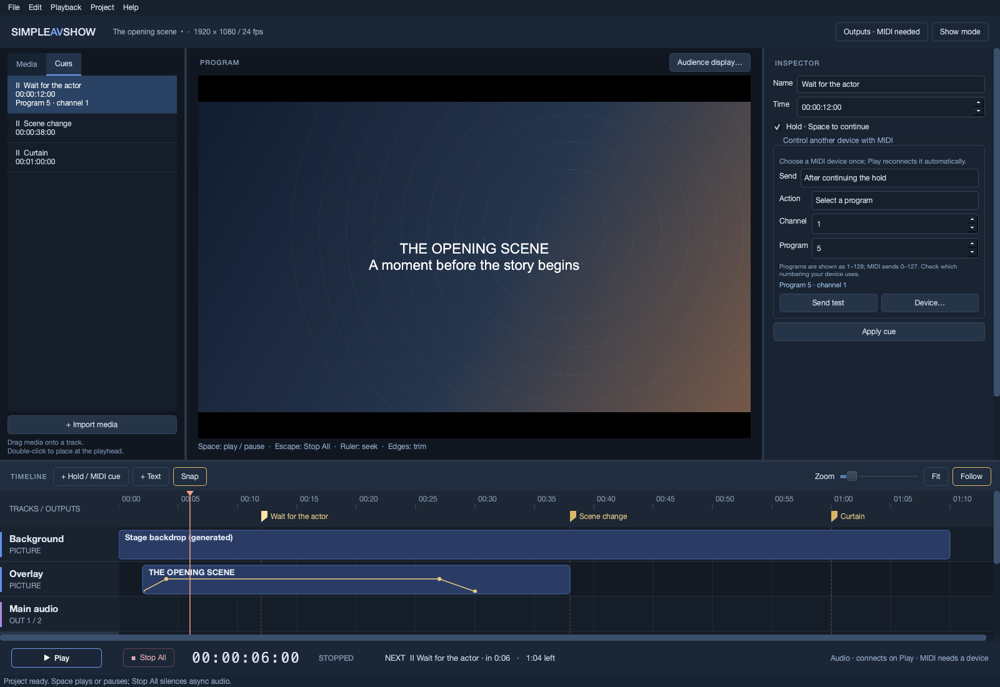

# 4. Cues and MIDI

[Manual contents](README.md) · Previous: [Audio and outputs](audio-and-outputs.md) · Next: [Running a show](running-a-show.md)

## Create a hold or timed cue

Stop All and leave Show mode. Seek to the desired time and click **+ Hold / MIDI cue**. A new **Hold N** appears at the playhead and is selected in the inspector.

- **Name** identifies the cue for the operator.
- **Time** is its position in show time; it accepts timecode or seconds like clip Start.
- **Hold · Space to continue** makes playback stop at the cue. Clear it for a timed cue that playback crosses without stopping.
- **Action → No message** creates a hold with no MIDI requirement.

Name/Time fields apply on Enter or leaving the field; the Hold checkbox applies immediately. Choose a descriptive name that explains the operator's decision, such as “Wait for actor at door.” MIDI message edits require **Apply cue**.

Click a flag on the timeline or an item in **Cues** to select it. Drag a flag or use nudge shortcuts to move its time. Double-clicking a Cues item seeks to it in edit mode. **Playback → Previous cue / Next cue** jumps to the strictly earlier/later cue relative to the playhead. Select and press Delete outside editing fields to remove a cue.

## Connect a MIDI destination

Open **Outputs** or the cue inspector's **Device…** button. Under **MIDI · control lights, instruments or other apps**, choose **Send cues to**. Selecting a destination connects immediately; **Reconnect MIDI device** retries it, and **Refresh devices** updates the list after plugging in equipment.

The app uses native MIDI output ports, including ports exposed by bridges or other applications. It does not create a receiver inside the external application; configure that application's MIDI input and channel separately.

The destination is remembered by name on this computer. Play reconnects it automatically. A missing destination does not fall back to a different port. **No MIDI device** disconnects the destination. Shows containing MIDI messages need an available destination to start normally; an existing live show can warn and continue when a MIDI/picture problem appears during a resume.

## Choose when the message fires

| **Send** setting | At a hold cue | At a non-hold cue |
| --- | --- | --- |
| **At this cue** | Sends once on arrival, then holds. | Sends when playback reaches it. |
| **After continuing the hold** | Sends once when the operator Continues. | Unavailable in the editor; non-hold messages fire on arrival. |

Seeking never sends a message. Landing exactly on a cue arms it for Play, so an arrival message can fire immediately when playback starts there. Seeking backward can rearm cues for rehearsal. Cues sharing a time are processed together: their arrival messages fire, any hold freezes playback, and their hold-resume messages fire when Continue releases that group.

## Use the guided message editor

Choose **Action**, fill the relevant fields, inspect the message summary, and click **Apply cue**. The summary's tooltip shows the outgoing hexadecimal bytes. Other hidden fields do not need to be filled.

| Action | Fields and interpretation |
| --- | --- |
| **No message** | Hold or cue only; sends nothing. |
| **Play a note** | Channel 1–16, Note 0–127, Velocity 1–127 for a sounding note. Velocity 0 means note-off. |
| **Stop a note** | Match the channel and note of the earlier note-on. Release velocity is 0–127. |
| **Change a control (CC)** | Channel, named/numbered Control 0–127, Value 0–127. Named options include Volume, Pan, Expression, Sustain, and All notes off. |
| **Select a program** | Channel and Program **1–128**. Outgoing MIDI numbers are **0–127**. |
| **Note pressure** | Channel, Note, Pressure 0–127. |
| **Channel pressure** | Channel and Pressure 0–127. |
| **Pitch bend** | Channel and Bend −8192…+8191; 0 is centered. The receiver sets the bend range in semitones. |
| **Raw MIDI / SysEx (advanced)** | One complete message, entered as hexadecimal bytes separated by spaces. |

Middle C is labeled **C4 · 60**; some receivers call MIDI note 60 C3. Check the note number rather than relying only on the octave name. Sustain is off below 64 and on from 64.

### Example: change an instrument after a stage wait

1. Add a hold and name it “Performer ready.”
2. Set **Send → After continuing the hold**.
3. Choose **Select a program**, Channel **1**, Program **5**.
4. Click **Apply cue**. The outgoing message is `C0 04`, because displayed programs are one-based.
5. Rehearse from before the cue: arrival holds without the program change; Continue sends it and resumes the timeline.

### Raw messages

Examples are `90 3C 64` (note-on, channel 1, note 60, velocity 100), `80 3C 00` (matching note-off), and `B0 07 64` (CC 7, value 100). They are examples of encoding, not device-specific commands.

SysEx must begin with `F0` and end with `F7`, and the payload must match the receiver's documented protocol. Enter one complete message rather than a list of separate commands. Invalid hex, missing bytes, and incomplete SysEx are reported inline; invalid messages cannot be applied or test-sent. Previously stored Note On messages with velocity 0 appear in Raw mode to preserve their exact bytes.

## Send a test

With playback stopped and Show mode off, use **Send test** to transmit the message currently displayed in the editor. This triggers the connected device immediately, without saving the cue or advancing show time. Test sending can reconnect the remembered destination. Choose a MIDI action first; No message sends nothing.

Apply cue and Send test are separate operations: a successful test does not store that message in the project. Click Apply cue before saving.

A note-on test does not automatically send note-off. Follow it with **Stop a note** for the matching channel/note, or use the receiver's own stop/panic control. **Stop All only stops SimpleAVShow's internal audio and cue scheduling; it does not send stop commands to external MIDI equipment.** Design explicit cleanup cues where your equipment needs them.

MIDI output runs on a separate worker and is not sample-timestamped hardware scheduling. Measure bridge/receiver latency and timing during [hardware validation](hardware-validation.md).
