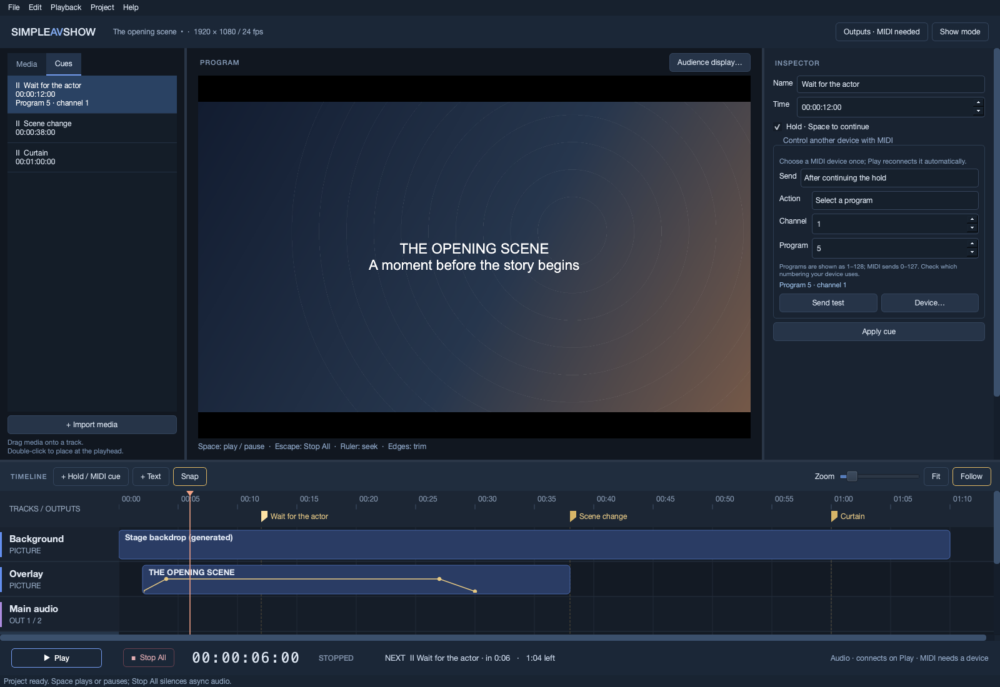

# 4. Cues and MIDI

[Manual contents](README.md) · Previous: [3. Audio and outputs](audio-and-outputs.md) · Next: [5. Running a show](running-a-show.md)

Cues let SimpleAVShow wait for live performers at **holds**, fire **MIDI messages** to lighting consoles, synthesizers, or other show software, or do both at the exact same moment.

---

## Create a hold or timed cue

Make sure playback is stopped (**Stop All**) and **Show mode** is off. Position the playhead where you want the cue and click **+ Hold / MIDI cue** on the timeline toolbar. A new **Hold N** flag appears on the ruler and opens in the inspector:

- **Name:** Give it a clear operator instruction—for example, *"Wait for actor at door"* rather than *"Hold 2"*.
- **Time:** Position in show time (accepts `HH:MM:SS:FF` timecode or seconds, just like clips).
- **Hold · Space to continue:** Checked by default, making playback pause at this cue until the operator presses **Space** or clicks **Continue**. Uncheck it to create a **timed cue** that fires on the fly without stopping playback.
- **Action → No message:** Keeps the cue purely as a hold or bookmark, with no MIDI device required.

**Name** and **Time** apply when you press Enter or leave the field, and the **Hold** checkbox applies immediately. Any changes to the MIDI message itself require clicking **Apply cue**.

### Navigating and managing cues

- Click a flag on the timeline or an entry in the **Cues** tab to select it.
- Drag a flag (or use the Alt+Arrow nudge shortcuts) to adjust its time.
- Double-click a cue in the **Cues** tab to seek straight to it in edit mode.
- Use **Playback → Previous cue** (**Ctrl+Left**) and **Next cue** (**Ctrl+Right**) to step between cues.
- Select a cue and press **Delete** or **Backspace** (outside editing fields) to remove it.

---

## Connect a MIDI destination

Open **Outputs** (or click **Device…** right inside the cue inspector) and look under **MIDI · control lights, instruments or other apps**.

1. Plug in your MIDI interface or start your MIDI bridge/receiving software, then click **Refresh devices**.
2. Pick your port under **Send cues to**—selecting a destination connects immediately.
3. Click **Reconnect MIDI device** if you need to retry a port, or choose **No MIDI device** to disconnect.

SimpleAVShow sends to native OS MIDI output ports (including virtual ports and bridges like loopMIDI or IAC). It does not configure the receiving app or console—set up the matching input port and MIDI channel there.

Just like audio outputs, your MIDI destination is remembered by name on this computer and reconnects automatically when you press **Play**. If the remembered port is missing, SimpleAVShow refuses to silently pick a different port. Starting a show that contains MIDI cues requires an available destination; if a MIDI problem happens mid-show while resuming from a hold or pause, SimpleAVShow warns you and lets the rest of the show continue.

---

## Choose when a MIDI message fires

| **Send** setting | On a Hold cue | On a non-hold (timed) cue |
| --- | --- | --- |
| **At this cue** | Fires once on arrival, right before holding. | Fires once as playback crosses the cue. |
| **After continuing the hold** | Fires once when the operator presses **Continue**. | Not available (timed cues always fire on arrival). |

Three timing rules keep rehearsal predictable:
- **Seeking never sends MIDI.** Scrubbing or jumping around the timeline will never fire a cue.
- **Exact landing arms the cue.** Seeking directly onto a cue arms it so an arrival message fires as soon as you press **Play**. Seeking earlier than a cue rearms it for another pass.
- **Same-time cues act as a group.** If multiple cues sit at the exact same time, all their arrival messages fire together, any hold in the group pauses playback, and pressing **Continue** fires all hold-resume messages in that group together.

---

## Build messages with the guided editor

Choose an **Action**, fill in the fields that appear, review the plain-English summary line, and click **Apply cue**. Hover over the summary line to inspect the exact outgoing hexadecimal bytes.

| Action | Fields & notes |
| --- | --- |
| **No message** | Hold or marker only; sends no MIDI. |
| **Play a note** | Channel `1–16`, Note `0–127`, Velocity `1–127` (`0` means note-off). |
| **Stop a note** | Match the Channel and Note of the earlier Note On; Release velocity `0–127`. |
| **Change a control (CC)** | Channel, named or numbered Control `0–127` (includes Volume, Pan, Expression, Sustain, and All notes off), Value `0–127`. |
| **Select a program** | Channel and Program **`1–128`**. *(Standard MIDI transmits zero-based `0–127` on the wire.)* |
| **Note pressure** | Polyphonic aftertouch: Channel, Note, Pressure `0–127`. |
| **Channel pressure** | Channel aftertouch: Channel, Pressure `0–127`. |
| **Pitch bend** | Channel and Bend `−8192…+8191` (`0` is center; pitch range in semitones is set on your receiver). |
| **Raw MIDI / SysEx (advanced)** | One complete message written as space-separated hex bytes. |

> **Watch out for octave naming and Sustain:** SimpleAVShow labels MIDI note 60 as **C4 · 60**, while some synths and DAWs call note 60 **C3**—always check the note number (`0–127`). For Sustain (CC 64), values below `64` are off and `64` or above are on.

### Walkthrough: switch an instrument patch after a stage wait

1. Add a hold cue and name it *"Performer ready"*.
2. Set **Send** to **After continuing the hold**.
3. Set **Action** to **Select a program**, **Channel** `1`, **Program** `5`.
4. Click **Apply cue**. Hover the summary to verify the outgoing bytes are `C0 04` (remembering programs are displayed 1–128 and sent 0–127).
5. Play from a few seconds before the cue: arrival holds silently without changing the patch, and pressing **Continue** sends `C0 04` as show time resumes.

### Raw MIDI and SysEx

If your lighting console or hardware expects custom bytes, pick **Raw MIDI / SysEx (advanced)** and enter one complete message separated by spaces:

- `90 3C 64` — Note On, channel 1, note 60, velocity 100
- `80 3C 00` — matching Note Off
- `B0 07 64` — CC 7 (Volume), channel 1, value 100
- `F0 ... F7` — SysEx (must start with `F0`, end with `F7`, and follow your device's protocol)

Enter one message per cue rather than chaining multiple commands. Invalid hex, missing bytes, or incomplete SysEx show an inline warning and cannot be applied or test-sent. Any previously saved Note On message with velocity `0` opens in Raw mode to preserve its exact bytes.

---

## Test MIDI cues safely

With playback stopped and Show mode off, click **Send test** to transmit whatever message is currently shown in the cue editor (reconnecting to the remembered MIDI port if needed).

Keep three safety habits in mind:
1. **Send test does not save.** A successful test only transmits the bytes—it does **not** store your changes in the cue. Always click **Apply cue** before saving the show.
2. **Stop notes you start.** Sending a test Note On won't automatically send a Note Off. Follow up with **Stop a note** on the same channel and note, or hit panic on the receiver.
3. **Stop All does not silence external MIDI gear.** **Stop All** only stops SimpleAVShow's internal audio and future cue scheduling. If your external synths or lighting rig need a blackout or all-notes-off message on abort or at the end of a show, build explicit cleanup cues or keep your receiver's panic button within reach.

> **Timing note:** MIDI cues run on a dedicated worker thread rather than sample-timestamped hardware clocks. Always measure your real bridge and receiver latency during [hardware validation](hardware-validation.md).
