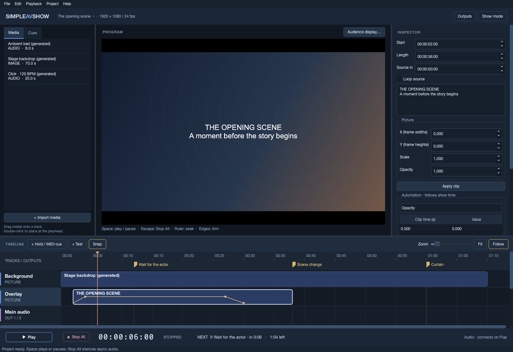
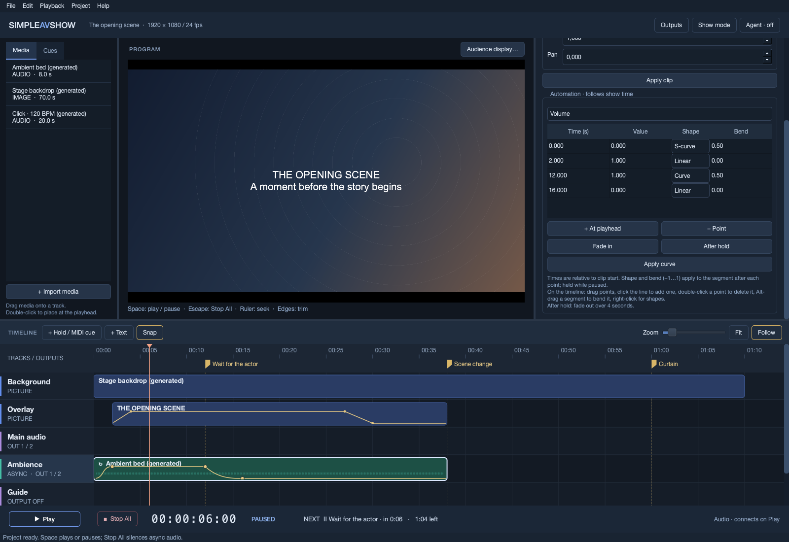
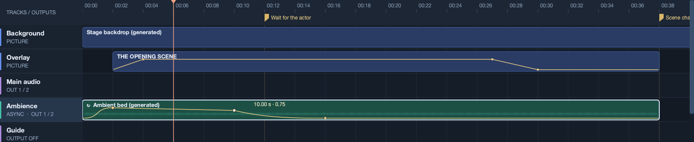
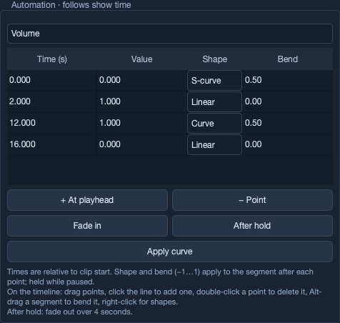

# 2. Editing a show

[Manual contents](README.md) · Previous: [1. Getting started](getting-started.md) · Next: [3. Audio and outputs](audio-and-outputs.md)

This chapter covers everything you do while building and refining a show: importing media, managing tracks, trimming and splitting clips, adding titles, and sculpting volume and picture automation.

---

## When editing is allowed

To protect live playback, SimpleAVShow locks editing whenever the show is running or busy. Before making changes:

- Click **Stop All** (not just Pause—a paused show may still have async audio or video running).
- Make sure **Show mode** is turned off.
- Wait for any media import or save progress dialog to finish.

When editing is locked, the inspector dims out so you can tell at a glance. Once unlocked, every accepted edit adds an undo step. **Edit → Undo** and **Edit → Redo** remember up to **32 steps**; opening or replacing a show clears history. If an edit isn't allowed (such as overlapping two pictures on one layer), SimpleAVShow leaves the project untouched and tells you why in the status bar.

---

## Import and place media

Bring files into the **Media** library in any of three ways: **File → Import media…**, the **+ Import media** button, or dragging files straight from Finder or File Explorer onto the window.

The file chooser accepts **WAV, AIFF/AIF, FLAC, MP3, OGG, M4A, MP4, MOV, MKV, WEBM, AVI, PNG, JPG/JPEG, BMP, and WebP** (actual decoding depends on the bundled libraries and the file's codec). While files prepare, a progress dialog appears. Hover over any imported item to see its source path; missing files show **OFFLINE · relink from File**.

To put an item on the timeline, **drag it from Media onto a compatible track**, or select a track header, place the playhead, and **double-click** the item.

| Media type | Where it goes |
| --- | --- |
| **Still image or video** | Any picture layer. |
| **Audio file** | Any audio or async audio track. |
| **Video with embedded audio** | Dropping on a picture layer creates a linked picture + audio pair (using the first matching synchronous or async audio track, if one exists). Dropping it directly on an audio track uses just its sound. |
| **Text** | Created directly on the timeline with **+ Text** (not imported into Media). |

Two placement rules to keep in mind:
- **Picture clips cannot overlap on the same layer.** To show two images together or crossfade between them, place them on separate picture layers.
- **Audio clips can overlap freely** on the same track; their levels simply sum together.

The end of the show is a dimmed area on the timeline, and you can still edit there. Dropping media or adding text past the end extends the duration to five seconds after the new clip. Moving, trimming, nudging, pasting, or duplicating a clip or cue past the end extends it just far enough to fit (one audio sample past a cue, so the cue still fires before the show ends). You can also click the ruler past the end to park the playhead there and add or paste items at that point. Playback won't start from past the end, and a seek past the end during playback jumps to the end.

---

## Work with tracks

Click any track header on the left of the timeline to inspect and configure it:

- **Name:** Label tracks clearly so you can scan them fast during rehearsal.
- **Mute / hide track:** Silences an audio track or hides a picture layer.
- **Keep playing through pauses / holds:** Turns a track into an **async** track (see [Synchronous vs. async audio and video](audio-and-outputs.md#synchronous-and-async-audio-and-video)).
- **Audio routing, volume, and pan:** Covered in [Chapter 3: Audio and outputs](audio-and-outputs.md).

To add more tracks, use **Project → Add track** and choose **Picture layer**, **Async picture layer**, **Audio**, or **Async audio**.

> **Warning:** Newly added audio tracks route to outputs **1 and 2** by default. Re-route private tracks (like extra guide or click feeds) immediately so they cannot reach audience speakers.

Picture layers stack like in other timeline editors: the topmost picture track is in front, and each track below it sits further back. **Overlay** draws over **Background**. To crossfade or layer graphics, put the incoming image on a picture track above the outgoing one and animate its opacity. (Shows saved by older versions, which drew the top track at the back, have their picture tracks reordered when opened so they look the same.)

To remove a track, select it (or any clip on it) and choose **Project → Delete selected track…**. The confirmation dialog tells you the track name and how many clips it contains. At least one track must remain in the project, and Undo brings a deleted track right back.

---

## Move, trim, zoom, and seek

- **Move a clip:** Drag its body left or right in time, or vertically onto another compatible track.
- **Trim the start:** Drag the clip's left edge. This adjusts **Start** and **Source in** together while keeping the clip's end anchored in place.
- **Trim the end:** Drag the clip's right edge to change **Length**. Non-looping audio and video stop at the end of their source file; enable **Loop source** to extend further.
- **Move a cue:** Drag its flag along the ruler, or nudge it with the keyboard.
- **Nudge selection:** Press **Alt+Left / Right** (Option+Left / Right on macOS) to nudge a selected clip or cue by one project frame, or **Alt+Shift+Left / Right** for one full second. Nudges stop cleanly at project boundaries.
- **Seek the playhead:** Click or drag in the ruler, click empty space in a track (which also selects that track), or double-click a clip in edit mode.

Timeline navigation tools on the toolbar:
- **Snap** *(on by default)* aligns drags to project frames, nearby clip edges, cue flags, the playhead, and `00:00:00:00`. Turn it off for freehand placement.
- **Zoom** and **Ctrl+mouse wheel** (Command+wheel on macOS) magnify around the cursor; **Fit** frames the whole show.
- **Follow** *(on by default)* keeps the playhead in view during playback. Manually scrolling horizontally temporarily pauses Follow so it doesn't fight you.

> **Note:** In edit mode, you can seek even while the show is playing—and seeking never fires MIDI cues. Switch to **Show mode** during a performance to prevent accidental timeline clicks.

---

## Clip timing and properties

Select any clip to inspect its timing and appearance on the right.

| Field | What it controls |
| --- | --- |
| **Start** | Show time when the clip begins. |
| **Length** | How long the clip lasts on the timeline. |
| **Source in** | Where inside the source file playback begins. |
| **Loop source** | Repeats from **Source in** to the end of the source file until the clip finishes. |
| **Gain / Pan** *(audio)* | Base volume and pan when no automation curve is active for that property. |
| **X / Y** *(picture)* | Offset from frame center in frame widths/heights (`+X` moves right, `+Y` moves down; `0.5` is half a screen). |
| **Scale** *(picture)* | Size multiplier (`1` fits the source cleanly inside the project frame). |
| **Opacity** *(picture)* | `0` is completely transparent; `1` is fully visible. |

### Entering timecode

**Start**, **Length**, **Source in**, and cue **Time** display `HH:MM:SS:FF` (at 24 fps, `00:00:12:12` is 12.5 seconds). When typing, you can also enter:
- Plain seconds: `12.5`
- Minutes and seconds: `01:30`
- Minutes, seconds, and frames: `01:30:12`

Keep in mind that the last number in a three- or four-part entry is a **frame count**, not decimal seconds, so it must be smaller than the project's frame rate.

### When edits take effect

- **Single-line numbers and names** apply as soon as you press **Enter** or leave the field.
- **Checkboxes and routing presets** apply immediately.
- **Multiline text** requires clicking **Apply clip**.
- **MIDI message edits** require clicking **Apply cue**.
- **Inspector automation table edits** require clicking **Apply curve** *(whereas dragging keyframes directly on the timeline applies as soon as you release the mouse)*.

Moving a clip carries its automation along with it. Left-trimming shifts clip-relative automation with the source content so the curve value and segment shape at the new start stay seamless. Note that edits and device changes rebuild playback state, so async source positions reset afterward.

---

## Linked video and audio

When you place a video that contains embedded audio onto a picture layer, SimpleAVShow automatically places its audio on the first matching audio track (synchronous for a regular picture layer, async for an async picture layer) and links the two clips together.

- **Timing stays locked together:** Moving, nudging, editing timing, trimming, splitting, or deleting either clip updates its linked partner too.
- **Properties stay independent:** Select the video clip to adjust picture transforms and opacity; select the audio clip to adjust gain, pan, and volume automation.
- **Separating them:** Select either clip and choose **Edit → Unlink clip** to break the link.

> **Note:** **Copy / Paste** and **Duplicate** only copy the single selected clip and clear its link. To duplicate both video and sound together, copy each clip and verify their alignment.

---

## Copy, duplicate, split, and delete

| Menu action | What it does |
| --- | --- |
| **Edit → Copy clip** | Copies the selected clip to the app's clip clipboard. |
| **Edit → Paste clip at playhead** | Pastes the copied clip at the playhead onto the selected compatible track. |
| **Edit → Duplicate clip** | Places an unlinked copy right after the selected clip (requires open space on picture layers; the show extends if the copy runs past the end). |
| **Edit → Split clip at playhead** | Cuts a non-looping clip when the playhead sits strictly inside it. Linked partners split together at the same time, and automation flows seamlessly across the cut. |
| **Edit → Unlink clip** | Detaches all clips sharing a link. |
| **Edit → Delete selected clip / cue** | Removes the selection (and any linked partners). |

Looping clips—and any clip linked to a looping partner—cannot be split, because loops always wrap back to **Source in**.

---

## Text and picture layers

To add a title or surtitle, select an open picture layer, move the playhead to where it should appear, and click **+ Text**. SimpleAVShow inserts a 10-second clip containing **Your text**. (If an audio track is selected when you click **+ Text**, the clip lands on the first picture layer—select your target layer first to avoid overlaps.)

Current text rendering is intentionally simple: centered, white, word-wrapped **Arial** sized proportionally to your project height. There is no font, color, or alignment picker yet, and system Arial can look slightly different across operating systems. Use **X/Y**, **Scale**, **Opacity**, and automation to place and animate text.

Still images and videos always keep their original aspect ratio and fit inside the project frame before any X/Y or Scale transforms are applied. On the audience display, the project frame itself scales to fit the monitor, adding black bars if the screen's aspect ratio differs.

---

## Automation and fade helpers

Automation lets a clip's volume, pan, position, scale, or opacity change smoothly over time.

Three important rules to understand before drawing curves:
1. **Curves follow show time**, measured in seconds from the clip's **Start**—not from a looping audio file's internal position. During a hold or pause, all curves freeze with show time (even on async tracks whose audio or video keeps running).
2. **A curve replaces the clip's base value** for that property (it does not multiply it). Track volume still multiplies clip volume on top. Clear all points on a curve to return to the clip's base value.
3. **Flat ends:** Before the first keyframe, the clip holds the first keyframe's value; after the last keyframe, it holds the last keyframe's value.

### Edit keyframes directly on the timeline

Any clip with automation draws its **Volume** curve (audio) or **Opacity** curve (picture) right on the clip. Whichever clip you select displays the property currently chosen in the inspector—drawn as a dashed line at its base value if it has no keyframes yet.

1. Select a clip and pick a property under **Automation · follows show time** in the inspector (**Volume** or **Pan** for audio; **Position X**, **Position Y**, **Scale**, or **Opacity** for picture).
2. Click the gold curve (or dashed base line) to add a keyframe, and drag it into place. A live readout shows clip-relative seconds and value as you drag.
3. Release the mouse to commit the change immediately as one undo step—no **Apply curve** button needed.

| Mouse gesture | Effect |
| --- | --- |
| **Click the selected clip's line** | Adds a new keyframe and lets you drag it right away. |
| **Drag a keyframe point** | Moves it in time and value, constrained between neighboring points and inside the clip (respects **Snap**). Hold **Shift** to lock time and adjust value only. |
| **Double-click a point** | Deletes that keyframe. |
| **Alt / Option-drag a segment** | Bends the segment between two points. Dragging up bows the curve upward; bending a Linear or Hold segment converts it to **Curve**. |
| **Right-click a point** | Delete the point or pick the shape of the segment leading to the next point. |
| **Right-click a segment** | Pick that segment's shape, or choose **Reset bend** to straighten a Curve or S-curve. |

You can even grab a visible point on an unselected clip to select and drag it in one motion. To move or trim the clip itself instead of editing its curve, grab away from the points and line (zoom in if points are crowded).

### Segment shapes

Every keyframe controls the shape of the segment running from itself to the **next** keyframe (so the final keyframe's shape and bend have no effect):

| Shape | How it moves |
| --- | --- |
| **Linear** | Constant straight-line change. |
| **Hold** | Stays flat at the keyframe's value, then steps abruptly at the next keyframe. |
| **Curve** | Exponential-style bend. Positive bend moves fast at first and eases in (great for natural audio fade-outs); negative bend starts gently and accelerates. |
| **S-curve** | Smooth ease-out and ease-in at both ends with positive bend; negative bend moves quickly at both ends and lingers in the middle. |

**Bend** ranges from **−1** to **+1** (`0` is straight). Switching a segment to **Curve** or **S-curve** from the timeline right-click menu nudges a `0` bend to `0.5` so you see the curve immediately; switching to **Linear** or **Hold** resets bend to `0`.

### Precision editing in the inspector table

For exact numbers, scroll to **Automation · follows show time** in the inspector:

1. Choose the property you want to edit.
2. Position the playhead where you want a keyframe and click **+ At playhead** to insert a row at the current interpolated value (clamped inside the clip).
3. Edit **Time (s)**, **Value**, **Shape**, and **Bend**. Note that table times are **clip-relative seconds** (not timecode) and always use a period (`.`) for decimals.
4. Select a row and click **− Point** to remove it.
5. Click **Apply curve** to commit the whole table as a single undo step. *(Always click **Apply curve** before switching clips, changing properties, or dragging points on the timeline.)*

### One-click fade helpers

Both helpers apply immediately as undoable edits:

- **Fade in:** Replaces the clip's **Volume** curve (audio) or **Opacity** curve (picture) with a 2-second linear fade from `0` up to the clip's base value (shortened automatically if the clip is under 2 seconds).
- **After hold:** Finds the next hold cue inside the selected clip at or after the playhead, keeps any earlier keyframes intact, anchors the current value at the hold, and ramps smoothly to `0` over 4 seconds after the hold (shortened if the clip ends sooner). While the show waits at the hold, the level stays steady; as soon as the operator presses **Continue**, the fade begins.

> **Tip for picture crossfades:** Place the outgoing image on **Background** and the incoming image overlapping it on **Overlay**, then fade **Overlay**'s opacity from `0` to `1`. Scrub the start and end of the crossfade to verify both layers look right in **PROGRAM**.
