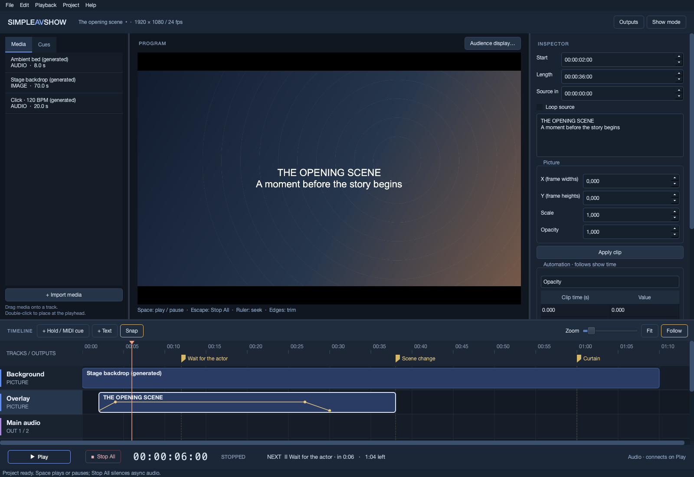
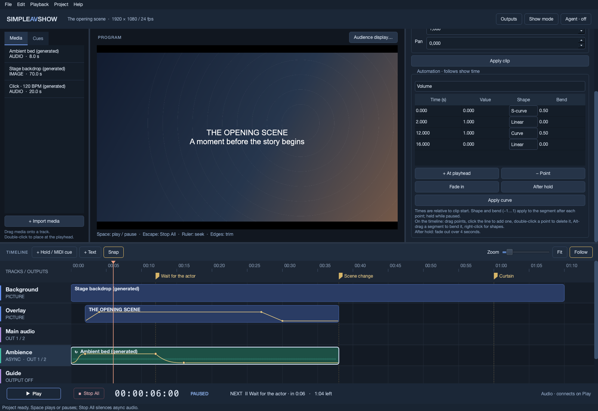
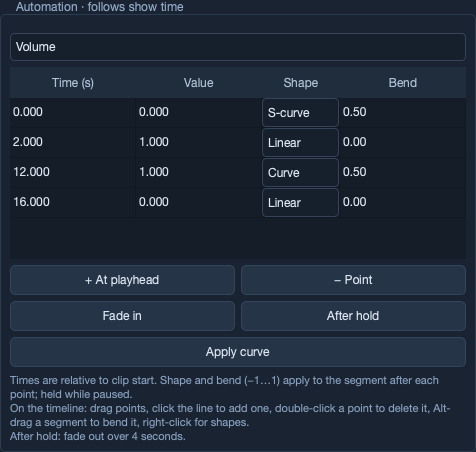

# 2. Editing a show

[Manual contents](README.md) · Previous: [Getting started](getting-started.md) · Next: [Audio and outputs](audio-and-outputs.md)

## Enter an editable state

Use **Stop All** and leave **Show mode**. Editing is blocked during Playing, Holding, media preparation, and while any async voices remain active. Paused playback is editable only when no async voices are running. The inspector is visibly disabled when editing is locked.

Each accepted project edit creates an undo step. **Edit → Undo/Redo** retains up to 32 undo steps; opening or replacing a show clears history. Invalid changes are rejected with an explanation in the status bar.

## Import and place media

Use **File → Import media…**, **+ Import media**, or drop media files from Finder/Explorer onto the editor. The file chooser lists WAV, AIFF/AIF, FLAC, MP3, OGG, M4A, MP4, MOV, MKV, WEBM, AVI, PNG, JPG/JPEG, BMP, and WebP. Actual decoding depends on the bundled media libraries and the file's codec/content.

Preparation runs with a progress dialog. Successful files appear in the Media library; failures are reported. Hover an item to see its source path. Generated demonstration sources have no file until saved/exported. Offline items are marked **OFFLINE · relink from File**.

To create a clip, drag an asset onto a compatible track at the desired time. Alternatively, select a track header, place the playhead, then double-click the asset in Media.

| Source | Compatible placement |
| --- | --- |
| Still image or video | Picture layer. |
| Audio file | Audio or async audio track. |
| Video with prepared embedded audio | Picture layer creates linked picture/sound when a synchronous audio track exists (an async audio track for an async picture layer); placing it on an audio track uses its audio. |
| Text | Created directly with **+ Text**, rather than imported into Media. |

The app can extend the project to accommodate a newly placed asset. Picture clips cannot overlap on the same layer; use another layer for simultaneous pictures or crossfades. Audio clips can overlap and their levels add.

## Select and manage tracks

Click a track header to show its inspector. Rename it in **Name**. **Mute / hide track** silences audio or hides a picture layer. **Keep playing through pauses / holds** makes the track async. Audio tracks also have routing, gain, and pan; see [chapter 3](audio-and-outputs.md).

Use **Project → Add track → Picture layer / Async picture layer / Audio / Async audio** to add a track. New audio tracks route to outputs 1/2 by default, so route them deliberately before a show.

Picture tracks compose in timeline order: Background is underneath later picture tracks. To blend two pictures, put them on separate layers and automate the upper clip's opacity.

**Project → Delete selected track…** names the current track and shows its clip count before deletion. The current track may be the track of a selected clip. Deletion removes that track's clips; at least one track must remain. Undo restores an accepted deletion.

## Move, trim, and seek

- Drag a clip's body to move it in time or onto another compatible track.
- Drag its left edge to change Start and Source in together while preserving the right edge.
- Drag its right edge to change Length. Non-looping audio/video cannot extend beyond the available source; enable **Loop source** to run longer.
- Click the ruler to seek. Clicking empty timeline space selects that track and also seeks. Double-clicking a clip seeks to that position in edit mode.
- Drag a cue flag to move its time. Clip/cue nudging is available from Edit and keyboard shortcuts.

**Snap** starts enabled. It snaps to project frames and nearby clip edges, cues, the playhead, and zero. Disable it for placement without snapping. **Fit** shows the whole project. The Zoom slider adjusts magnification; Ctrl+wheel zooms around the cursor. **Follow** keeps the playhead visible during playback; manual horizontal scrolling temporarily suspends following.

Seeking is allowed in edit mode even during playback. It never sends MIDI. Use Show mode to prevent accidental timeline jumps during a performance.

## Edit clip timing and properties

Select a clip to show its inspector.

| Control | Meaning |
| --- | --- |
| **Start** | Show time at which the clip begins. |
| **Length** | Duration occupied on the timeline. |
| **Source in** | Offset into the source when the clip begins. |
| **Loop source** | Repeat from Source in to source end for the clip's timeline duration. |
| **Gain / Pan** | Base audio values when that property has no automation. |
| **X (frame widths) / Y (frame heights)** | Picture displacement from center. Positive X moves right; positive Y moves down. `0.5` means half a project width/height. |
| **Scale** | Picture size multiplier: `1` is the normal fitted size. |
| **Opacity** | `0` is transparent; `1` is fully visible. |

Start, Length, Source in, and cue Time display **HH:MM:SS:FF**. At 24 fps, `00:00:12:12` is 12.5 seconds. These fields also accept plain seconds (`12.5`), minutes/seconds (`01:30`), or minutes/seconds/frames (`01:30:12`). The last part of a three- or four-part entry is a frame number, not decimal seconds. Frame numbers must be below the project's frame-rate ceiling.

Numeric/name fields apply when you press Enter or leave the field. Checkboxes and routing presets apply immediately. The **Apply track**, **Apply clip**, and **Apply cue** buttons remain available. For multiline text, click **Apply clip** after editing. MIDI message choices require **Apply cue**; automation table changes require **Apply curve**.

Moving a clip keeps its automation relative to the clip. A left trim shifts automation with the source content and preserves the value and segment shape at the new beginning. Edits and device changes rebuild playback state; async source cursors do not persist through those operations.

## Linked video and audio

Placing video with embedded audio on a picture track creates a sound companion on the first synchronous audio track, if one exists. The clips share a link: **moving, nudging, changing timing, trimming, splitting, and deleting either clip affect its linked partners**.

Select the picture clip for picture properties and the sound clip for gain/pan. Those properties remain independent. To move them independently, select either and choose **Edit → Unlink clip**.

**Copy/Paste** and **Duplicate** copy only the selected clip and clear the copied link. They do not create a second linked pair. If duplicating a complete video section, copy both components and check their alignment.

## Copy, duplicate, split, and delete

| Action | Result |
| --- | --- |
| **Edit → Copy clip** | Copies the selected clip to the app's clip clipboard. |
| **Paste clip at playhead** | Places that copy on the selected compatible track at the playhead. |
| **Duplicate clip** | Places an unlinked copy directly after the selected clip. Space must be available on a picture layer and within project duration. |
| **Split clip at playhead** | Divides a non-looping clip when the playhead is strictly inside it. Linked partners split together where they contain that time. Automation continues across the cut. |
| **Unlink clip** | Separates all clips sharing that link. |
| **Delete selected clip / cue** | Deletes the selection. Deleting a linked clip deletes its partners. |

Looping clips cannot be split, because their loop starts at Source in. Unlinking does not change that restriction. Nudge a selected clip or cue one frame with Alt+Left/Right, or one second with Alt+Shift+Left/Right. Nudges stop at project boundaries.

## Text and picture layers

Select an empty picture layer, seek, and click **+ Text**. The new clip starts at the playhead, lasts ten seconds, and contains **Your text**. If an audio track is selected, the app uses the first picture layer; choose a picture layer explicitly to avoid overlap.

Text is centered, white, word-wrapped, and rendered using system Arial at a size derived from project height. The current UI has no font, color, or alignment chooser. Use X/Y, Scale, Opacity, and their automation to position or animate it. Appearance can vary across operating systems.

Still images and video preserve their aspect ratio and fit inside the project frame before transformations. The program preview/output then fits the project frame to its display, with black bars where aspect ratios differ.

## Automation and fade helpers

Automation values follow **show time**, measured relative to clip Start. They do not follow the looping source's playback position. When a property has keyframes, its curve supplies that property's value; it does not multiply the base clip value. Track gain still multiplies clip volume.

### On the timeline

Every clip draws its Volume (audio) or Opacity (picture) curve; the selected clip draws the property chosen in the inspector, with a dashed line at its base value when it has no keyframes. While editing is allowed:

| Mouse | Result |
| --- | --- |
| Drag a point | Moves it in time and value. Times stay between the neighbouring points and inside the clip, and follow **Snap**. Hold Shift to change only the value. |
| Click the selected clip's line | Adds a point on the line and lets you drag it straight away. |
| Double-click a point | Deletes it. |
| Alt/Option-drag a segment | Bends it into a **Curve**; dragging up bows the line upwards. |
| Right-click a point or line | Deletes the point or chooses the shape of the segment that follows it. |

The cursor shows what a press would grab. Points on unselected clips can be dragged directly; that selects the clip. A drag elsewhere on the clip still moves or trims it. Each change is one undo step.

### Segment shapes

Each keyframe sets the shape of the segment that runs to the next keyframe:

| Shape | Behaviour |
| --- | --- |
| **Linear** | Straight line. |
| **Hold** | Keeps the keyframe's value, then jumps at the next keyframe. |
| **Curve** | Positive bend changes quickly first and settles into the next point (a natural audio fade-out); negative bend starts slowly and accelerates. |
| **S-curve** | Positive bend eases out of one point and into the next; negative bend does the opposite, moving quickly at both ends. |

Bend runs from −1 to 1; 0 is a straight line. Choosing Curve or S-curve from the timeline menu starts at bend 0.5.

### In the inspector

1. Select the clip and scroll to **Automation · follows show time**.
2. Choose **Volume**, **Pan**, **Position X**, **Position Y**, **Scale**, or **Opacity**.
3. Seek to a useful position and click **+ At playhead** to add a row with the current interpolated value. The time is clamped to the selected clip's duration.
4. Edit **Time (s)**, **Value**, **Shape**, and **Bend**, using a decimal point for decimal table entries. Times here are seconds relative to clip Start, not timecode.
5. Select a row and use **− Point** to remove it.
6. Click **Apply curve**. Times are sorted; duplicate times, negative times, bends outside −1…1, and values outside the property's range are rejected. Apply the table before changing the selection/property.

Before the first keyframe they use its value; after the last they keep the final value. An empty curve restores the base clip value. All curves freeze during pauses and holds, including curves on async audio whose source keeps playing.

**Fade in** replaces the Volume curve on audio, or Opacity curve on picture, with a two-second linear ramp from zero to the base value, shortened if the clip is shorter. It applies immediately.

**After hold** finds the earliest following hold inside the selected clip, at or after the playhead. It preserves earlier points, places the current curve value at the hold, and fades to zero over four seconds, shortened at clip end. It applies immediately. While the hold lasts, the fade is frozen; continuing starts the fade. If no following hold is inside the clip, the status bar explains why no fade was created.

For a picture crossfade, overlap clips on separate layers and fade the upper layer's opacity. Check both layers at the intended start and end positions in the preview.
