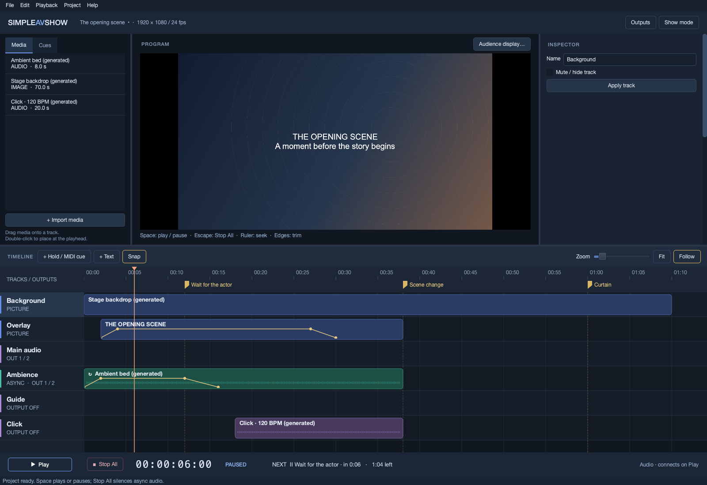
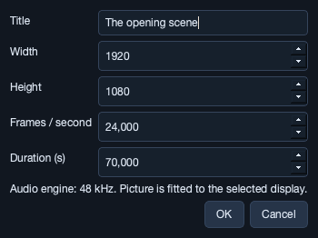

# 1. Getting started

[Manual contents](README.md) · Next: [2. Editing a show](editing-a-show.md)

This chapter gets SimpleAVShow running on your computer, gives you a quick tour of the interface, walks you through the built-in demonstration, and guides you through building a short show from scratch.

---

## Install and launch

Download the package for your platform from the [Downloads section of the README](../README.md#downloads). Always keep the bundled libraries and third-party notices alongside the app—no extra SDKs or package managers are needed.

| Platform | Steps |
| --- | --- |
| **Windows 11 (x64)** | Extract the entire ZIP archive into a folder, then run `bin/simpleavshow.exe`. Do not move the `.exe` out of its folder on its own. |
| **macOS 15+ (Apple Silicon)** | Extract the ZIP and drag `simpleavshow.app` into **Applications**. Intel Macs are not supported. |
| **Linux (x64)** | Make the AppImage executable (`chmod +x`) and run it. Built for Ubuntu 24.04 (glibc 2.39+). If FUSE is unavailable, launch with `APPIMAGE_EXTRACT_AND_RUN=1`. |

> **Note:** Prerelease packages are unsigned (macOS builds use ad-hoc signing without notarization), so Windows or macOS may show a standard downloaded-app prompt on first launch. Check the `README.txt` included in your package if needed. To build from source instead, see [CONTRIBUTING.md](https://github.com/SimpleAVL/simpleAVshow/blob/main/CONTRIBUTING.md).

When SimpleAVShow opens, it starts with a fresh, empty project. If an untitled autosave was left behind from an earlier session, it offers to recover it. To open an existing `.savshow` project or `.savpack` package, use **File → Open…** or drop the file straight onto the window.

---

## Tour the workspace

| Area | What it does |
| --- | --- |
| **Top bar** | Shows the project title, resolution, and frame rate, plus buttons for **Outputs**, **Show mode**, **Remote**, and **Agent**. A dot beside the title (and an `*` in the window title) means you have unsaved changes. |
| **Media tab** *(upper left)* | Lists every media file imported into the project. Importing a file adds it here without placing it on the timeline yet. |
| **Cues tab** *(upper left)* | Lists all holds and MIDI cues in show-time order. Click a cue to select it; double-click to jump the playhead there (in edit mode). |
| **PROGRAM** *(center)* | Live preview of the composed audience picture. Click **Audience display…** to open fullscreen output settings. |
| **INSPECTOR** *(right)* | Settings for whatever you have selected—a track, a clip, or a cue. Scroll down to reach automation and lower controls. |
| **Timeline toolbar** | Quick buttons for **+ Hold / MIDI cue**, **+ Text**, **Snap**, **Zoom**, **Fit**, and **Follow**. |
| **Timeline** *(lower pane)* | Track headers on the left, clips and cue flags in the middle, time ruler across the top, and the playhead line. Scroll horizontally for time and vertically for tracks. |
| **Transport bar** *(bottom)* | **Play / Pause / Continue**, **Stop All**, main timecode clock, playback state, next cue countdown, remaining show time, and system health indicators. |
| **Status bar** *(very bottom)* | Confirms imports and saves, and explains why an edit or action was blocked. Playback warnings also appear directly below the **PROGRAM** preview. |

> **Tip:** Drag the dividers between panels to give the preview, inspector, or timeline more breathing room. The window has a minimum size of 1100 × 720; on smaller laptops, collapse unused panel space and scroll inside the inspector.

---

## Run the built-in demonstration

The fastest way to see how holds and async ambience feel is to play the built-in 70-second demo.

1. Choose **File → Open demonstration**. It loads a generated stage backdrop, fading title text, a looping ambient bed, a click track, and three stage holds.
2. Click **Fit** on the timeline toolbar to see the whole 70 seconds at once. **Follow** is on by default so the timeline scrolls with the playhead when zoomed in.
3. Click any empty spot in the timeline (or the **PROGRAM** preview) so keyboard focus is outside text fields.
4. Click **Play** or press **Space**. On first launch, SimpleAVShow prepares your system's default audio output; later launches remember whichever device you chose.
5. Watch what happens at **00:00:12:00**: playback pauses itself at the hold cue **Wait for the actor**. The clock and picture freeze, while the ambient bed keeps looping smoothly underneath.
6. Press **Space** or click **Continue**. Show time resumes, and the ambient bed fades out over the next four seconds. Two more holds wait at 38 and 60 seconds.
7. Click **Stop All** when you're done. (If you switched into Show mode, leave it before editing.)

Two details worth noticing in the demo:
- **The Click track is silent on purpose.** Both of its outputs start set to **Off** so click tracks never leak into audience speakers until you route them.
- **Demo media is generated in memory** and only turns into real PNG and WAV files (stored in a sibling `.media` folder) if you save the project.

If **Play** fails, check the banner under **PROGRAM** and the status bar, then see [Connect an audio output](audio-and-outputs.md#connect-an-audio-output) or [Troubleshooting](reference-and-troubleshooting.md#troubleshooting). Remember that if a previously used audio device is unplugged, SimpleAVShow blocks playback on purpose instead of silently switching to your laptop speakers.

---

## Build your first show

Let's put together a short scene with a picture, sound, a title, and a stage hold.

### 1. Configure project settings

Choose **File → New show**, then open **Project → Project settings…**.

Set your **Title**, **Width**, **Height**, **Frames / second**, and **Duration (s)**, then click **OK**. A new show starts at 1920 × 1080, 24 fps, and 60 seconds.

- **Pick resolution and frame rate early**, before doing frame-accurate timing.
- **Duration is entered in seconds** here, even though the transport and clip/cue inspectors display `HH:MM:SS:FF` timecode.
- **You don't have to get the duration right up front.** The show grows on its own when you place, move, or trim a clip or cue past the end. Setting a duration shorter than your last clip or cue keeps it at that clip or cue; trim or move items near the end first to shorten the show.
- Audio always runs at **48 kHz**, regardless of your picture frame rate.

### 2. Arrange a simple scene

Every new show starts with six tracks ready to use: **Background** and **Overlay** (picture layers), **Main audio** and **Ambience** (async audio), plus **Guide** and **Click** (disconnected/silent by default).

1. Click **+ Import media**, select an image and an audio file, and wait for preparation to finish.
2. Drag the image from the **Media** tab onto the **Background** track at the start of the show.
3. Drag the audio file onto **Main audio** where you want it to begin.
4. Click the **Overlay** track header, click the timeline ruler where a title should appear, and click **+ Text**.
5. Select the new text clip, replace **Your text** in the inspector, and click **Apply clip**. Adjust its **Start** and **Length** if needed.
6. Click the ruler where you want the show to wait for a performer, then click **+ Hold / MIDI cue**. Name it something unmistakable—like *"Wait for performer ready"*—and leave **Hold · Space to continue** checked.
7. Save your work with **File → Save** to create a `.savshow` file.
8. Click the start of the ruler, press **Space**, and practice releasing the hold with **Continue**.

> **Note:** Dropping media or adding text that ends within five seconds of the end—or past it—extends the show to five seconds after the new clip. Moving, trimming, or nudging past the end extends it exactly to the item. Playback stops at the shaded end of the timeline, so check **Project settings…** before rehearsing your ending.

Ready to go deeper? Continue to [Chapter 2: Editing a show](editing-a-show.md) for precision trimming, linked video/audio, and automation curves.
