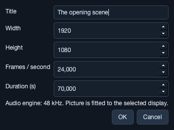

# 1. Getting started

[Manual contents](README.md) · Next: [Editing a show](editing-a-show.md)

## Install and launch

Use the packages linked under **Downloads** in the [repository README](../README.md#downloads). Keep the included runtime libraries and third-party notices with the application.

| Platform | Installation |
| --- | --- |
| Windows 11 x64 | Extract the entire ZIP into a folder, then run `bin/simpleavshow.exe`. Moving only the executable leaves its dependencies behind. |
| macOS 15 or newer, Apple Silicon | Extract the ZIP and move `simpleavshow.app` into Applications. Intel Macs are outside the supported targets. |
| Linux x64 | The AppImage targets Ubuntu 24.04/glibc 2.39 or newer. Make it executable, then run it. If FUSE is unavailable, use `APPIMAGE_EXTRACT_AND_RUN=1`. |

The prerelease packages are unsigned; macOS builds use ad-hoc signing without notarization. Follow the included `README.txt` for downloaded-app prompts. SDKs and Homebrew are not required for packaged builds. To build from source, follow [CONTRIBUTING.md](https://github.com/staubichsauger/simpleAVshow/blob/main/CONTRIBUTING.md) in the source repository.

The app opens a new, empty show. If an untitled autosave from a previous session exists, startup offers recovery. You can open a `.savshow` or `.savpack` through **File → Open…**, or drop a single show/package file onto the window.

## Tour the workspace

| Area | Purpose |
| --- | --- |
| Top bar | Project title, resolution, frame rate, **Outputs**, and **Show mode**. A dot beside the title indicates unsaved changes; the window title also gains an asterisk. |
| **Media** tab, upper left | Imported assets available to place on the timeline. Importing a file does not place a clip automatically. |
| **Cues** tab | Holds and MIDI cues, ordered by show time. Click to select; double-click to seek in edit mode. |
| **PROGRAM**, center | Preview of the composed audience picture. **Audience display…** opens output settings. |
| **INSPECTOR**, right | Controls for the selected track, clip, or cue. Scroll this panel to reach automation and lower controls. |
| Timeline toolbar | Add a cue or text, toggle **Snap**, adjust **Zoom**, **Fit** the show, and enable **Follow**. |
| Timeline | Track headers, clips, a ruler, cue flags, and the playhead. Scroll horizontally for time and vertically for tracks. |
| Bottom transport | Play/Pause/Continue, Stop All, timecode, playback state, next cue, remaining show time, and health indicators. |
| Status bar | Results of imports/saves and explanations of blocked actions or errors. Playback problems can also appear below the program preview. |

Drag the splitters between panels to give the preview, inspector, or timeline more space. The editor has a minimum size of 1100 × 720; on smaller screens, use panel scrolling and collapse unused space with the splitters.

## Try the demonstration

1. Choose **File → Open demonstration**. It contains a generated backdrop, title text, looping ambience, a click source, and three holds.
2. Click **Fit** to see the whole 70-second show. Turn **Follow** on to keep the playhead visible during playback.
3. Click a blank part of the timeline or the program preview to move focus away from editing fields.
4. Click **Play** or press **Space**. On first use, the app prepares the default audio output. Later it restores the remembered device by name.
5. At **00:00:12:00**, the show holds at **Wait for the actor**. The title and clock freeze. Ambience continues looping.
6. Press **Space** or click **Continue**. The ambience fades out over four seconds of resumed show time. The next holds are at 38 and 60 seconds.
7. Click **Stop All** when finished. Leave Show mode, if enabled, before making edits.

The Click track starts with both outputs **Off**, so the demonstration's click is silent until routed. The generated backdrop, ambience, and click become PNG/WAV files in a sibling `.media` folder when you save the demo.

If Play fails, read the banner and status bar, then use [audio setup](audio-and-outputs.md#connect-an-audio-output) or [troubleshooting](reference-and-troubleshooting.md#troubleshooting). A missing remembered device blocks playback until you reconnect it or explicitly choose a replacement.

## Create a first show

### Set the project

Choose **File → New show**, then **Project → Project settings…**.

Set **Title**, **Width**, **Height**, **Frames / second**, and **Duration (s)**, then click **OK**. A new show defaults to 1920 × 1080 at 24 fps and 60 seconds. Project settings use seconds for duration; the transport and clip/cue inspectors display timecode.

Choose the delivery resolution and frame rate before fine timing work. Reducing duration below an existing clip or cue is rejected; shorten or remove those items first. Audio always uses a 48 kHz engine, regardless of project frame rate.

### Build a simple scene

1. Click **+ Import media** and choose a picture and an audio file. Wait for preparation to finish.
2. Drag the picture from Media onto **Background** at the start of the show.
3. Drag the sound onto **Main audio** at the desired time.
4. Click the **Overlay** track header, seek to the desired title time using the ruler, and click **+ Text**.
5. Select the text clip, replace **Your text** in the inspector, and click **Apply clip**. Adjust Start and Length as needed.
6. Seek to a point where an operator must wait, then click **+ Hold / MIDI cue**. Give it a meaningful name, such as “Wait for performer ready.” Leave **Hold · Space to continue** checked.
7. Choose **File → Save** and save a `.savshow` file.
8. Seek to the beginning, press Play, and rehearse the hold and Continue operation.

The default tracks are Background and Overlay picture layers, Main audio, async Ambience, Guide, and Click. Main audio and Ambience route to outputs 1/2; Guide and Click are silent. Use [chapter 3](audio-and-outputs.md) before routing guide or click to hardware.

Adding a media or text clip can extend project duration to leave five seconds after the new clip. Check the final Duration before rehearsing the ending.

Continue with [Editing a show](editing-a-show.md) for precise timing, linked video/audio, and fades.
