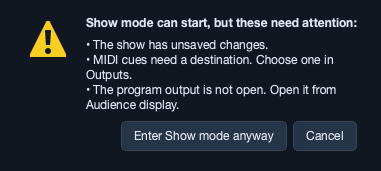
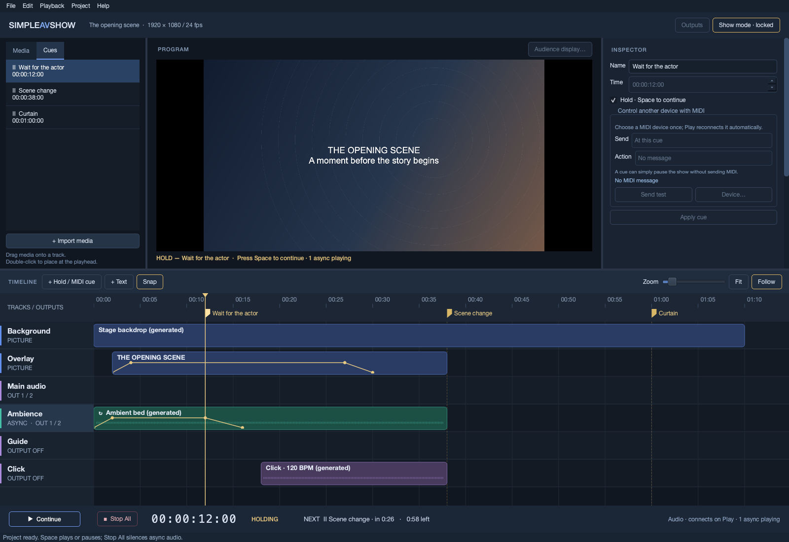
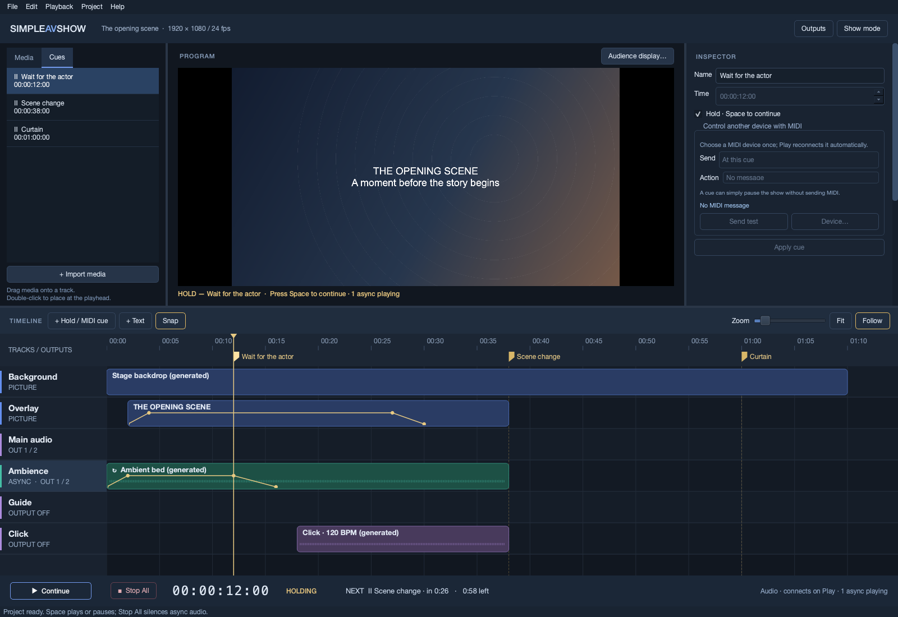

# 5. Running a show

[Manual contents](README.md) · Previous: [Cues and MIDI](cues-and-midi.md) · Next: [Saving and recovery](saving-and-recovery.md)

## Rehearse in edit mode

1. Open the project or package. Resolve offline media and save a normal project copy if you opened a package.
2. Select audio, MIDI, and audience-display destinations on this computer.
3. Verify Main, Ambience, Guide, and Click on their actual physical outputs.
4. Seek to the beginning or a rehearsal cue. Seek does not fire MIDI; Play at an exact cue can.
5. Play through every hold, pause, Continue, fade, and scene boundary using the final media.
6. Watch the health indicators and record any clipping, underruns, waits, or retries.
7. Complete at least one full rehearsal on the target computer with the actual interface, MIDI bridge/receiver, and display. Use the [hardware-validation guide](hardware-validation.md) for physical tests.

For a repeat run, click **Stop All**, then seek to zero in edit mode. Stop All itself does not rewind. Home seeks to zero when the timeline has focus. Seeking backward may rearm cues; allow for the effects of replaying external MIDI commands.

## Before the performance

- Confirm the intended project/version and final duration. Save all changes.
- Confirm every required source is online and no playback problem is unresolved.
- Verify audio driver, device, open channel count, buffer stability, track routing, and levels.
- Verify the MIDI destination and each required external-device action, including cleanup messages.
- Open fullscreen program output on the audience display; check framing and the held picture.
- Stop All, position the playhead at the intended starting point, and make sure Guide/Click cannot reach audience channels.
- Enable Follow if you want the timeline to page with the playhead. Put keyboard focus outside editing fields.
- Enter Show mode and review its preflight warnings.

## Enter Show mode

Click **Show mode**. The preflight checks unsaved changes, missing media used on the timeline, MIDI destinations, audio availability/routing where it can inspect them, and whether a required program output is open.

If issues exist, **Cancel** is the default. Fix them, then retry. **Enter Show mode anyway** is an explicit override for a known rehearsal situation; it does not fix destinations or bypass Play's own checks. Preflight cannot establish real cabling, external-device response, or performance capacity.

The button becomes **Show mode · locked**. Editing, saving/exporting, timeline seeks, and Outputs access are blocked. Space still toggles playback, and Stop All remains available. The inspector is disabled. Play can prepare/reconnect remembered devices while stopped; leave Show mode to choose a different destination.

Leaving Show mode while Playing, Holding, or with async voices running requires confirmation. Even after leaving, editing remains blocked until playback/async activity stops. Quitting while Show mode or playback is active also asks for confirmation; Cancel keeps the session open.

## Operate the transport

| State | What is happening | Primary button / Space |
| --- | --- | --- |
| **STOPPED** | Internal voices are stopped at the current position. | Play begins there. |
| **PLAYING** | Show time advances; audio, picture, and cues follow it. | Pause freezes show time; async audio can continue. |
| **PAUSED** | Manual pause or a non-playing seek. | Play resumes from that position. |
| **HOLDING** | A hold cue has frozen show time. | Continue releases the hold and sends its resume MIDI, if configured. |
| **ENDED** | The project duration has been reached and voices have stopped. | Seek earlier in edit mode before starting again. |

The large clock is **HH:MM:SS:FF** at project frame rate. **NEXT** shows the next cue's name/type and time until it; **left** shows remaining timeline duration. These are show-time durations: they do not predict wall-clock finishing time when performers spend additional time at holds. While holding, NEXT points to the following cue.

### Holds

At a hold, the button reads **Continue**, the state reads **HOLDING**, and the banner names the cue. Normal audio stops sounding and the picture freezes. Already-running async sources continue playing or finish naturally. Their automation stays at the held value. Press Space or click Continue when the stage is ready.

Space inside a text field, spin-box editor, combo box, or automation cell editor belongs to that control. Click the timeline/preview or focus a transport control before relying on Space as a show control.

### Pause and Stop All

Pause is useful when show time must wait without ending ambience. It is not silence-all. Click **Stop All** to stop all internal voices, including async audio, at the current position.

In edit mode, Escape invokes Stop All outside editing controls; inside a field it can cancel editing. In Show mode, press **Escape twice within 600 ms** to Stop All. The first press prompts for the second. The Stop All button always takes one click. Held pictures remain at the current position after Stop All; it is not a blackout command.

External MIDI equipment does not receive an automatic stop message. Stop/panic that equipment separately or use intentionally programmed MIDI cleanup cues.

## Respond to a problem

Read the persistent banner below PROGRAM, the bottom health readout, and the status bar. An audio device that fails/stalls stops playback; a missing remembered output prevents a new start. Restore it and press Play to retry, or leave Show mode and choose a replacement in Outputs.

An unreadable/changed audio source stops playback. Restore temporarily unavailable media and retry; reopen the show to reload changed sources or rebuild damaged caches. A fatal video reader error holds its last picture and reports a warning while audio/cues continue. A display disconnect hides the audience window and reports its reconnect behavior. Check the actual audience output rather than only the editor preview.

For changing connections or files: Stop All, leave Show mode, fix the fault, then rehearse the affected section and reposition deliberately. See [troubleshooting](reference-and-troubleshooting.md#troubleshooting) for specific symptoms.

## End the session

At project end, all internal voices stop. Confirm external equipment has reached its desired state. To edit/save afterward, leave Show mode. Close the program output from Outputs if needed, save edits, and quit. When prompted to quit an active session, **Stop and quit** stops the app's audio/cue scheduling/output; Cancel keeps the app running.
