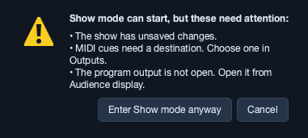
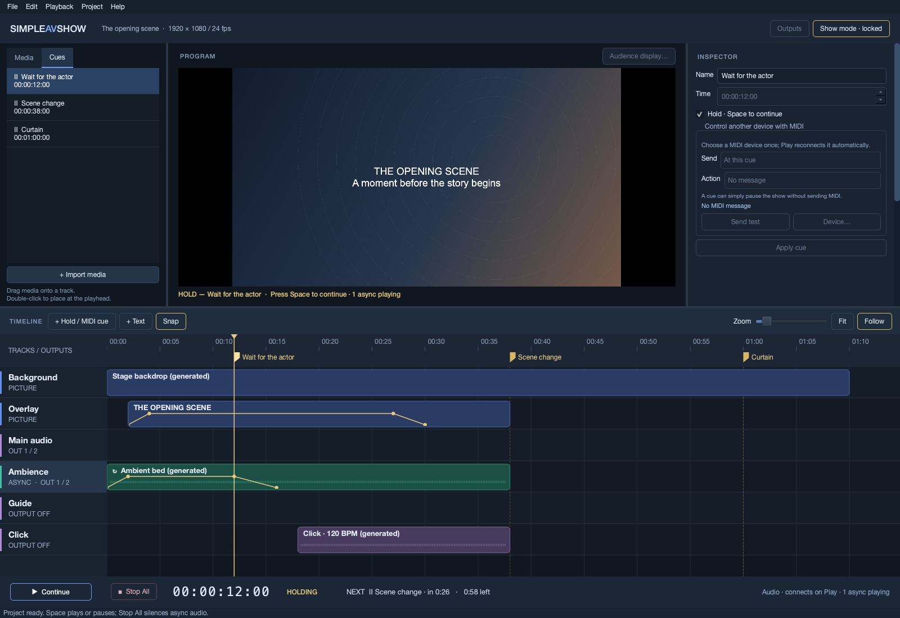
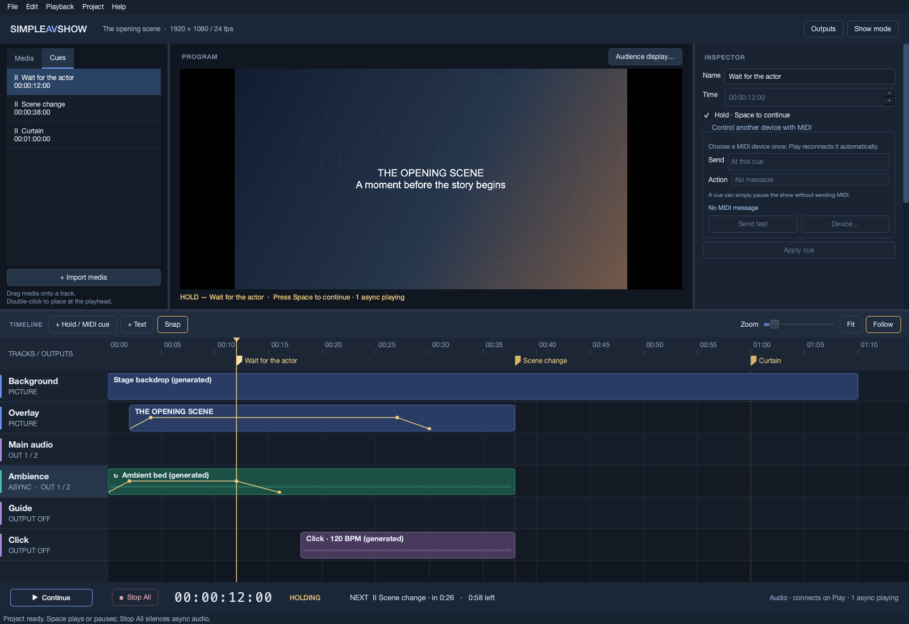

# 5. Running a show

[Manual contents](README.md) · Previous: [4. Cues and MIDI](cues-and-midi.md) · Next: [6. Phone remote](remote-control.md)

This chapter takes you from final rehearsal to curtain up: checking readiness with Show mode's preflight screen, operating holds and pauses calmly, handling problems mid-show, and shutting down cleanly.

---

## Rehearse in edit mode first

Before locking down Show mode, run at least one full technical rehearsal on the actual show machine:

1. Open your project or package. If you opened a `.savpack`, resolve any offline files and **Save** a permanent `.savshow` copy first.
2. Open **Outputs** and verify your audio interface, MIDI destination, and audience display on this computer.
3. Send audio to **Main**, **Ambience**, **Guide**, and **Click** and confirm each one arrives at the right physical output.
4. Move the playhead to the start (or any cue you're rehearsing). Remember: seeking never sends MIDI, though pressing **Play** directly on a cue fires its arrival message.
5. Play straight through every hold, pause, **Continue**, fade, and scene transition using your final media files.
6. Keep an eye on the health indicators at the bottom right—note any clipping, underruns, audio/video waits, or disk retries.
7. Run the full physical checks in the [Show-machine validation checklist](hardware-validation.md) before your first audience.

> **Tip for repeat runs:** **Stop All** silences playback without rewinding the playhead. To run a scene again, click **Stop All**, then click the start of the ruler (or focus the timeline and press **Home**) in edit mode. Keep in mind that seeking backward rearms cues—make sure replaying MIDI messages won't put your lighting console or instruments into an unexpected state.

---

## Pre-show checklist

Work through this quick list right before house opens:

- [ ] **Right show file:** Confirm you have the latest version, expected final duration, and **no unsaved changes** (no dot beside the title).
- [ ] **All media online:** No **OFFLINE** items in Media and no unresolved warnings below **PROGRAM**.
- [ ] **Audio verified:** Correct driver (ASIO on Windows), interface, open channel count, buffer size, routing, and headroom. Confirm **Guide** and **Click** cannot reach audience speakers.
- [ ] **MIDI verified:** Correct destination port connected, cues tested, and any needed end-of-show cleanup messages in place.
- [ ] **Audience display open:** Fullscreen program output is open on the projector/monitor, framed properly, and holding the right opening frame.
- [ ] **Cued to start:** Click **Stop All** and place the playhead at your starting position (`00:00:00:00` or your preset cue).
- [ ] **Operator ready:** **Follow** is on if you want the timeline to track playback, and keyboard focus is outside text/number fields.
- [ ] **Show mode locked:** Click **Show mode** and resolve every preflight warning.

---

## Enter Show mode

Click **Show mode** in the top bar. SimpleAVShow runs a quick **preflight check** for unsaved changes, missing timeline media, unconfigured MIDI destinations, audio device/routing issues it can inspect, and whether a needed fullscreen program output is open.

If preflight flags anything, **Cancel** is highlighted by default—go fix the issue and click **Show mode** again. **Enter Show mode anyway** is only for deliberate rehearsal overrides; it does not fix missing devices or bypass **Play**'s own checks. *(Preflight also cannot verify physical cables, external consoles, or real-time CPU headroom—that's what rehearsal is for.)*

Once active, the top-bar button switches to **Show mode · locked**:
- **Protected:** Timeline edits, seeks, saving/exporting, and opening **Outputs** are all blocked, and the inspector is dimmed out.
- **Ready to run:** **Space**, the **Play / Pause / Continue** button, **Stop All**, and the [Phone remote](remote-control.md) keep working normally.
- **Remembered devices still reconnect on Play** while stopped, though choosing a different device requires leaving Show mode first.

Leaving Show mode while playing, holding, or running async audio/video asks for confirmation (and editing still stays locked until you **Stop All**). Quitting while Show mode or playback is active also prompts before stopping, with **Cancel** keeping the show alive.

---

## Operate the transport

| Transport state | What the show is doing | Primary button / **Space** |
| --- | --- | --- |
| **STOPPED** | All internal audio/video voices are stopped at the playhead. | **Play** — starts playback here. |
| **PLAYING** | Show time advances; audio, video, and cues run normally. | **Pause** — freezes show time (async tracks keep playing). |
| **PAUSED** | Manually paused, or parked after a seek. | **Play** — resumes from here. |
| **HOLDING** | Stopped at a hold cue waiting for stage action. | **Continue** — releases the hold and fires any hold-resume MIDI. |
| **ENDED** | Reached the end of project duration; all voices have stopped. | Seek earlier in edit mode before starting again. |

### Reading the clock and countdowns

- **Main clock:** Current show time in `HH:MM:SS:FF` at the project frame rate.
- **NEXT:** Name/type of the upcoming cue and show time until it arrives. While holding, **NEXT** looks ahead to the *next* cue after the current hold.
- **left:** Remaining timeline duration.

Remember that **NEXT** and **left** measure **show time**, not wall-clock time—any extra minutes performers spend at a hold won't shrink them.

### Working with holds

When playback reaches a hold cue, the primary button turns into **Continue**, the status reads **HOLDING**, and the banner names the cue. Normal audio stops and the stage picture freezes; any already-running **async** audio or video keeps playing smoothly with its automation frozen at the hold's level. Press **Space** or click **Continue** when the stage is ready.

> **Keyboard focus tip:** If your cursor is inside a text box, number field, dropdown, or automation table cell, **Space** types into that control instead of running the show. Before curtain, click the timeline, preview, or a transport button so **Space** always controls playback.

### Pause vs. Stop All

- **Pause** freezes show time while letting async ambience or projections keep running. Use it when you need to wait unexpectedly without cutting the room tone. It is **not** a silence-all command.
- **Stop All** silences every internal voice immediately—including all async audio and video—without moving the playhead.
  - Clicking the **Stop All** button always takes **one click**.
  - With the keyboard: press **Escape** once in edit mode (outside editing fields), or **Escape twice within 600 ms** in Show mode (the first press prompts you for the second, preventing accidental stops).
  - **Stop All** holds the current picture at the playhead—it is **not** a video blackout.
  - **Stop All** does **not** send MIDI stop or panic commands to external gear. Silence or reset external synths and lighting separately, or trigger a dedicated cleanup cue.

Need to step away from the desk during tech or run cues from backstage? You can also trigger **Play / Pause / Continue** and **Stop All** from a phone or tablet—see [Chapter 6: Phone remote](remote-control.md).

---

## Handle problems calmly

If something goes wrong mid-show, check three places: the banner directly below **PROGRAM**, the health readout at the bottom right, and the status bar.

- **Audio device dropped or stalled:** Playback stops. If a cable bumped loose, reconnect the interface and press **Play** to retry it. To switch to a backup device instead: click **Stop All**, leave **Show mode**, pick the replacement in **Outputs**, and confirm routing.
- **Unreadable or modified audio file:** Playback stops. Restore a temporarily unavailable drive/file and press **Play**; if a file was modified or a cache damaged, reopen the show after stopping.
- **Fatal video decode error:** SimpleAVShow holds the last good picture and raises a warning so **audio and MIDI cues keep running**. Fix and reopen the source after stopping.
- **Audience display disconnected:** SimpleAVShow hides the output window and warns you; if the same monitor reconnects (away from the editor screen), it tries to reopen automatically. Always eyeball the physical projector rather than trusting the editor preview alone.

Whenever you need to fix hardware or files, follow the safe sequence: **Stop All → leave Show mode → fix the issue → verify → re-cue deliberately**. See [Troubleshooting](reference-and-troubleshooting.md#troubleshooting) for specific messages and fixes.

---

## Wrap up after the show

At the end of the project duration, all internal voices stop automatically.

1. Confirm external lighting and MIDI gear are in their post-show state.
2. Leave **Show mode** if you want to save tweaks or inspect settings.
3. Close the audience display from **Outputs** (or focus it and press **Ctrl+W** / **Command+W**).
4. Save any final changes and quit. If prompted while active, **Stop and quit** shuts down audio, cues, and program output cleanly; **Cancel** keeps your session open.
